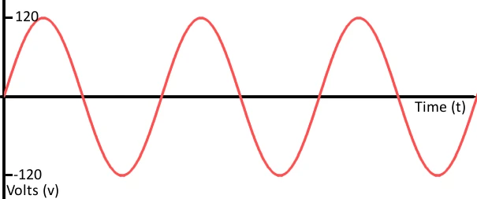
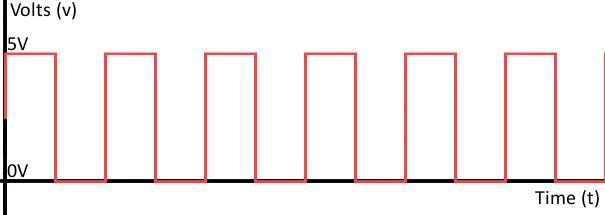
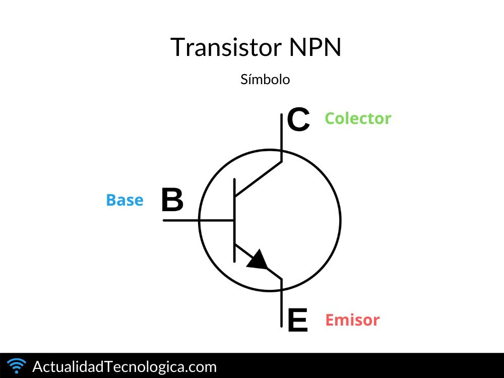
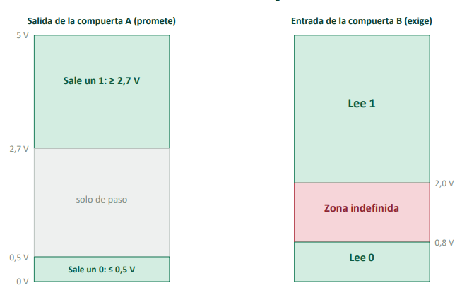

# ⚙️ `SISTEMAS NUMÉRICOS, CÓDIGOS Y COMPUERTAS LÓGICAS` ⚙️

## 📡 1. Tipos de Señales

> 🌊 **Señal Analógica**  
> Es continua y adopta infinitos valores.  
> 

> 💻 **Señal Digital**  
> Solo adopta dos valores (`0` y `1`).  
> 

---

## 🧩2. Circuitos combinacionales
Circuito que aplica la lógica combinacional para realizar una función específica.
### 🧠Lógica Combinacional  
> Su salida en cualquier instante depende **únicamente de sus entradas en ese mismo momento**.

* ❌ **Sin memoria:** No almacena ni recuerda datos de operaciones pasadas.  
* 🔄 **Cambio directo:** Si las entradas cambian, la salida cambia inmediatamente.

---

## ⚙️3. TRANSISTOR
Es un semiconductor que funciona como interruptor eléctrico o como amplificador de señales.
> Varios transistores interconectados forman una compuerta lógica. 

<table>
  <tr>
    <td width="50%" align="center" valign="top">
      
    </td>
    <td width="50%" valign="top">
      <h3>Base</h3>
      
Controla el paso de la corriente, tiene una pequeña corriente (corriente de control) que controla el paso de corriente desde el Emisor al Colector mediante un diodo.

      <h3>Emisor</h3>
      
Se encarga de emitir o "inyectar" los electrones al transitor.

      <h3>Colector</h3>
      
Esta diseñada para "colectar" o recolectar los portadores de carga que vienen desde el emisor.

    </td>
  </tr>
</table>

---

## ⚡ 4. Rangos de Voltaje en Señales Digitales

  

#### 🚧 Zona Indefinida
- Franja de confusión para el receptor entre 0,8 V y 2,0 V.
- El componente no reconoce si recibe un 0 o un 1 y no sabe cómo actuar.
- Ocurre por ruido eléctrico, interferencias, pérdida de voltaje en cables largos o pines desconectados.

#### 🔄 Zona Solo de Paso
- Rango intermedio de salida ubicado entre 0,5 V y 2,7 V.
- Se llega a ella porque el cambio de 0 V a 5 V no es instantáneo y requiere un tiempo físico de conmutación.
- La señal únicamente atraviesa este rango a gran velocidad.

### 🛡️ Margen de Ruido

Es la protección que evita que la señal caiga en la **zona indefinida** cuando hay interferencias.

* **Margen Alto (0,7 V):** Lo que puede bajar un 1 en el camino y seguir leyéndose como 1.
* **Margen Bajo (0,3 V):** Lo que puede subir un 0 por interferencia y seguir leyéndose como 0.

Al superar estos límites, la señal cae en la **zona indefinida** y el sistema falla por confusión.

Ejemplo de falla: si sale un 0 de 0,5 V y un motor cercano le suma 0,4 V de ruido, la señal sube a 0,9 V y la compuerta ya no sabe qué hacer.

