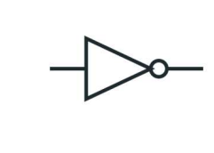
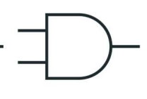
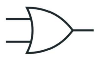
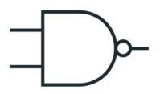
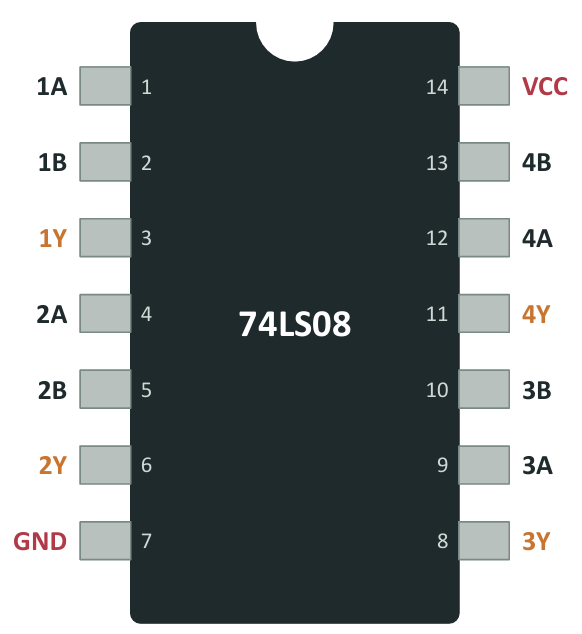

# ⚙️ `SISTEMAS NUMÉRICOS, CÓDIGOS Y COMPUERTAS LÓGICAS` ⚙️

## 📡 1. Tipos de Señales

> 🌊 **Señal Analógica**  
> Es continua y adopta infinitos valores.  
> 

> 💻 **Señal Digital**  
> Solo adopta dos valores (`0` y `1`).  
> 

---

## 🧩2. Circuitos combinacionales
Circuito que aplica la lógica combinacional para realizar una función específica.
### 🧠Lógica Combinacional  
> Su salida en cualquier instante depende **únicamente de sus entradas en ese mismo momento**.

* ❌ **Sin memoria:** No almacena ni recuerda datos de operaciones pasadas.  
* 🔄 **Cambio directo:** Si las entradas cambian, la salida cambia inmediatamente.

---

## ⚙️3. TRANSISTOR
Es un semiconductor que funciona como interruptor eléctrico o como amplificador de señales.
> Varios transistores interconectados forman una compuerta lógica. 

<table>
  <tr>
    <td width="50%" align="center" valign="top">
      
    </td>
    <td width="50%" valign="top">
      <h3>Base</h3>
      
Controla el paso de la corriente, tiene una pequeña corriente (corriente de control) que controla el paso de corriente desde el Emisor al Colector mediante un diodo.

      <h3>Emisor</h3>
      
Se encarga de emitir o "inyectar" los electrones al transitor.

      <h3>Colector</h3>
      
Esta diseñada para "colectar" o recolectar los portadores de carga que vienen desde el emisor.

    </td>
  </tr>
</table>

---

## ⚡ 4. Rangos de Voltaje en Señales Digitales

  

#### 🚧 Zona Indefinida
- Franja de confusión para el receptor entre 0,8 V y 2,0 V.
- El componente no reconoce si recibe un 0 o un 1 y no sabe cómo actuar.
- Ocurre por ruido eléctrico, interferencias, pérdida de voltaje en cables largos o pines desconectados.

#### 🔄 Zona Solo de Paso
- Rango intermedio de salida ubicado entre 0,5 V y 2,7 V.
- Se llega a ella porque el cambio de 0 V a 5 V no es instantáneo y requiere un tiempo físico de conmutación.
- La señal únicamente atraviesa este rango a gran velocidad.

### 🛡️ Margen de Ruido

Es la protección que evita que la señal caiga en la **zona indefinida** cuando hay interferencias.

* **Margen Alto (0,7 V):** Lo que puede bajar un 1 en el camino y seguir leyéndose como 1.
* **Margen Bajo (0,3 V):** Lo que puede subir un 0 por interferencia y seguir leyéndose como 0.

Al superar estos límites, la señal cae en la **zona indefinida** y el sistema falla por confusión.

Ejemplo de falla: si sale un 0 de 0,5 V y un motor cercano le suma 0,4 V de ruido, la señal sube a 0,9 V y la compuerta ya no sabe qué hacer.

---

## 🔢 5. Posiciones Binarias
* Cada posición vale el doble de la anterior (1, 2, 4, 8...); solo sumas los valores donde hay un **1**.
* **Bit:** Un solo dígito (0 o 1). **Byte:** Conjunto de 8 bits.

---

## 🔢 6. De Decimal a Binario: Dividir entre 2

Para convertir un número decimal a binario se divide sucesivamente entre 2 y se guardan los restos.

#### Pasos:
1. Dividir el número entre 2.
2. Anotar el **resto** (0 o 1) y guardar el **cociente**.
3. Repetir la división con el nuevo cociente hasta llegar a 0.
4. Leer los restos de **abajo hacia arriba** para obtener el número binario.

---

#### Ejemplo (Número 25):

| División | Cociente | Resto |
| :---: | :---: | :---: |
| 25 ÷ 2 | 12 | **1** |
| 12 ÷ 2 | 6 | **0** |
| 6 ÷ 2 | 3 | **0** |
| 3 ÷ 2 | 1 | **1** |
| 1 ÷ 2 | 0 | **1** |

**Resultado:** 25₁₀ = **11001₂**

* **Comprobación:** 16 + 8 + 1 = 25

---

## 🔣 7. Hexadecimal y Octal: Abreviaturas del Binario

### 1. Hexadecimal (Base 16)
- **Significado:** Sistema de numeración de base 16 que utiliza los números del 0 al 9 y las letras de la A a la F.
- **Uso de la tabla:** Del 10 en adelante se emplean letras para evitar escribir dos dígitos en una sola posición.
- **Agrupación y regla de ceros:** Agrupa el código binario en bloques de **4 bits** de derecha a izquierda. Si al último grupo le faltan bits, se completan con ceros a la izquierda.

| Decimal | Hexadecimal |
| :---: | :---: |
| 10 | **A** |
| 11 | **B** |
| 12 | **C** |
| 13 | **D** |
| 14 | **E** |
| 15 | **F** |

- **Ejemplo (Número 157 = 10011101₂):**
  1. Separa de 4 en 4 bits desde la derecha: `1001` | `1101`.
  2. Convierte cada bloque: `1001` = 9 y `1101` = 13.
  3. Reemplaza el 13 por la letra **D**.
  - **Resultado Hexadecimal:** **9D₁₆**

### 2. Octal (Base 8)
- **Significado:** Sistema de numeración posicional de base 8 que utiliza únicamente los dígitos del 0 al 7.
- **Por qué se utiliza:** Métodos sencillos para representar binarios largos sin necesidad de usar letras, ya que ningún bloque supera el valor de 7.
- **Agrupación y regla de ceros:** Agrupa el código binario en bloques de **3 bits** de derecha a izquierda. Si el primer grupo no completa los 3 bits, se le agregan ceros a la izquierda.
- **Ejemplo (Número 157 = 10011101₂):**
  1. Separa de 3 en 3 bits desde la derecha: `010` | `011` | `101` *(se agrega un 0 a la izquierda para completar)*.
  2. Convierte cada bloque a decimal: `010` = 2, `011` = 3 y `101` = 5.
  - **Resultado Octal:** **235₈**

---

<h2>➕ 8. Aritmética Binaria y Números con Signo</h2>

<h3>1. Suma Binaria</h3>

Operación básica columna por columna. Si el resultado supera el valor de 1, se genera un <b>acarreo</b> (<i>carry</i>) hacia la siguiente columna.

<ul>
  <li><code>0 + 0 = 0</code></li>
  <li><code>0 + 1 = 1</code></li>
  <li><code>1 + 0 = 1</code></li>
  <li><code>1 + 1 = 10₂</code> <i>(escribo 0 y llevo 1 de acarreo)</i></li>
  <li><code>1 + 1 + 1 = 11₂</code> <i>(escribo 1 y llevo 1 de acarreo)</i></li>
</ul>

<h4>Ejemplo de Suma (11 + 6 = 17):</h4>
<pre><code>  111    &lt;- Acarreos
  1011   (11 en decimal)
+ 0110   (6 en decimal)
------
 10001   (17 en decimal)</code></pre>

<h3>2. Representación de Números Negativos: Complemento a Dos (C2)</h3>

Dado que los circuitos digitales solo entienden <code>0</code> y <code>1</code> y no poseen el símbolo <code>-</code>, se utiliza el convenio de <b>Complemento a Dos</b>.

<blockquote style="background-color: #f6f8fa; border-left: 4px solid #0969da; padding: 10px;">
  💡 <b>Regla para obtener el negativo de un número (-B):</b>
  <ol>
    <li><b>Invertir</b> todos los bits (cambiar 0 por 1 y 1 por 0).</li>
    <li><b>Sumar 1</b> al resultado.</li>
  </ol>
</blockquote>

<pre><code>Ejemplo: Obtener -3 a partir de +3 (en 4 bits)
  0011   (+3 en binario)
&gt; 1100   (Invertir bits -&gt; Complemento a 1)
&gt; 1101   (Sumar 1 -&gt; Representa el -3 en C2)</code></pre>

<ul>
  <li><b>Bit de Signo:</b> El bit más a la izquierda indica el signo (<code>0</code> = Positivo, <code>1</code> = Negativo).</li>
  <li><b>Rango en 4 bits:</b> De <b>-8 a +7</b> (<code>1000₂</code> a <code>0111₂</code>).</li>
  <li>⚡ <b>Ventaja:</b> Permite realizar restas utilizando el mismo circuito sumador: <i>A - B = A + (-B)</i>.</li>
  <li>⚠️ <b>Overflow (Desbordamiento):</b> Ocurre cuando el resultado supera los bits disponibles (ejemplo: sumar dos positivos y que el bit de signo cambie a negativo).</li>
</ul>

<h2>📑 9. Códigos Digitales</h2>

  <b>🔢 BCD (Binary-Coded Decimal)</b> 
  Representa cada dígito decimal (0-9) de manera independiente usando bloques de <b>4 bits</b>.
  <ul>
    <li><b>Uso:</b> Displays de 7 segmentos en relojes y calculadoras.</li>
    <li><b>Nota:</b> Las combinaciones de <code>1010₂</code> (10) a <code>1111₂</code> (15) son inválidas.</li>
    <li><i>Ejemplo:</i> 157₁₀ → <code>0001</code> (1) | <code>0101</code> (5) | <code>0111</code> (7) = <b>000101010111_BCD</b>.</li>
  </ul>

  <b>🔄 Código Gray</b> 
  Código no ponderado en el que entre dos números consecutivos <b>solo cambia 1 solo bit</b>.
  <ul>
    <li><b>Uso:</b> Evita errores de lectura en sensores de posición rotativos (<i>encoders</i>) e integra la base de los Mapas de Karnaugh.</li>
    <li><i>Comparación (3 → 4):</i> En binario cambian 3 bits a la vez (<code>011</code> → <code>100</code>), mientras que en Gray solo cambia 1 bit (<code>010</code> → <code>110</code>).</li>
  </ul>

  <b>🔤 Código ASCII</b> 
  Formato estándar de 7 u 8 bits para representar letras, números y caracteres de control.
  <ul>
    <li><i>Ejemplo:</i> Tu equipo guarda la letra <code>'A'</code> como el valor decimal 65₁₀ = <b>01000001₂</b>.</li>
  </ul>

<h2>🚪 10. Compuertas Lógicas</h2>

Las compuertas lógicas son los bloques básicos constitutivos de los circuitos combinacionales.

<h3>1. Compuertas Básicas</h3>

<h4>⏺️ NOT (Inversor)</h4>

<i>Invierte el estado lógico de su entrada. Ecuación: Y = A'</i>

<table width="100%">
  <tr>
    <td width="40%" align="center" valign="middle">
      
    </td>
    <td width="60%" valign="middle">
      <table border="1" cellspacing="0" cellpadding="5" width="100%">
        <thead>
          <tr align="center">
            <th>Entrada (A)</th>
            <th>Salida (Y)</th>
          </tr>
        </thead>
        <tbody>
          <tr align="center">
            <td>0</td>
            <td><b>1</b></td>
          </tr>
          <tr align="center">
            <td>1</td>
            <td><b>0</b></td>
          </tr>
        </tbody>
      </table>
    </td>
  </tr>
</table>

<h4>🤝 AND</h4>

<i>Salida 1 únicamente si todas las entradas son 1. Ecuación: Y = A · B</i>

<table width="100%">
  <tr>
    <td width="40%" align="center" valign="middle">
      
    </td>
    <td width="60%" valign="middle">
      <table border="1" cellspacing="0" cellpadding="5" width="100%">
        <thead>
          <tr align="center">
            <th>A</th>
            <th>B</th>
            <th>Salida (Y)</th>
          </tr>
        </thead>
        <tbody>
          <tr align="center">
            <td>0</td>
            <td>0</td>
            <td><b>0</b></td>
          </tr>
          <tr align="center">
            <td>0</td>
            <td>1</td>
            <td><b>0</b></td>
          </tr>
          <tr align="center">
            <td>1</td>
            <td>0</td>
            <td><b>0</b></td>
          </tr>
          <tr align="center">
            <td>1</td>
            <td>1</td>
            <td><b>1</b></td>
          </tr>
        </tbody>
      </table>
    </td>
  </tr>
</table>

<h4>🔀 OR</h4>

<i>Salida 1 si al menos una de las entradas es 1. Ecuación: Y = A + B</i>

<table width="100%">
  <tr>
    <td width="40%" align="center" valign="middle">
      
    </td>
    <td width="60%" valign="middle">
      <table border="1" cellspacing="0" cellpadding="5" width="100%">
        <thead>
          <tr align="center">
            <th>A</th>
            <th>B</th>
            <th>Salida (Y)</th>
          </tr>
        </thead>
        <tbody>
          <tr align="center">
            <td>0</td>
            <td>0</td>
            <td><b>0</b></td>
          </tr>
          <tr align="center">
            <td>0</td>
            <td>1</td>
            <td><b>1</b></td>
          </tr>
          <tr align="center">
            <td>1</td>
            <td>0</td>
            <td><b>1</b></td>
          </tr>
          <tr align="center">
            <td>1</td>
            <td>1</td>
            <td><b>1</b></td>
          </tr>
        </tbody>
      </table>
    </td>
  </tr>
</table>

<h3>2. Compuertas Negadas y Específicas</h3>

<h4>🚫 NAND (Universal)</h4>

<i>Es la negación de la compuerta AND. Salida 0 únicamente cuando todas las entradas son 1. Ecuación: Y = (A · B)'</i>

<table width="100%">
  <tr>
    <td width="40%" align="center" valign="middle">
      
    </td>
    <td width="60%" valign="middle">
      <table border="1" cellspacing="0" cellpadding="5" width="100%">
        <thead>
          <tr align="center">
            <th>A</th>
            <th>B</th>
            <th>Salida (Y)</th>
          </tr>
        </thead>
        <tbody>
          <tr align="center">
            <td>0</td>
            <td>0</td>
            <td><b>1</b></td>
          </tr>
          <tr align="center">
            <td>0</td>
            <td>1</td>
            <td><b>1</b></td>
          </tr>
          <tr align="center">
            <td>1</td>
            <td>0</td>
            <td><b>1</b></td>
          </tr>
          <tr align="center">
            <td>1</td>
            <td>1</td>
            <td><b>0</b></td>
          </tr>
        </tbody>
      </table>
    </td>
  </tr>
</table>

<h4>⛔ NOR (Universal)</h4>

<i>Es la negación de la compuerta OR. Salida 1 únicamente cuando todas las entradas son 0. Ecuación: Y = (A + B)'</i>

<table width="100%">
  <tr>
    <td width="40%" align="center" valign="middle">
      
    </td>
    <td width="60%" valign="middle">
      <table border="1" cellspacing="0" cellpadding="5" width="100%">
        <thead>
          <tr align="center">
            <th>A</th>
            <th>B</th>
            <th>Salida (Y)</th>
          </tr>
        </thead>
        <tbody>
          <tr align="center">
            <td>0</td>
            <td>0</td>
            <td><b>1</b></td>
          </tr>
          <tr align="center">
            <td>0</td>
            <td>1</td>
            <td><b>0</b></td>
          </tr>
          <tr align="center">
            <td>1</td>
            <td>0</td>
            <td><b>0</b></td>
          </tr>
          <tr align="center">
            <td>1</td>
            <td>1</td>
            <td><b>0</b></td>
          </tr>
        </tbody>
      </table>
    </td>
  </tr>
</table>

<h4>🔲 XOR (OR Exclusiva)</h4>

<i>Salida 1 si las entradas son diferentes entre sí. Ecuación: Y = A ⊕ B</i>

<table width="100%">
  <tr>
    <td width="40%" align="center" valign="middle">
      
    </td>
    <td width="60%" valign="middle">
      <table border="1" cellspacing="0" cellpadding="5" width="100%">
        <thead>
          <tr align="center">
            <th>A</th>
            <th>B</th>
            <th>Salida (Y)</th>
          </tr>
        </thead>
        <tbody>
          <tr align="center">
            <td>0</td>
            <td>0</td>
            <td><b>0</b></td>
          </tr>
          <tr align="center">
            <td>0</td>
            <td>1</td>
            <td><b>1</b></td>
          </tr>
          <tr align="center">
            <td>1</td>
            <td>0</td>
            <td><b>1</b></td>
          </tr>
          <tr align="center">
            <td>1</td>
            <td>1</td>
            <td><b>0</b></td>
          </tr>
        </tbody>
      </table>
    </td>
  </tr>
</table>

<h4>🔳 XNOR (Equivalencia)</h4>

<i>Salida 1 si las entradas son iguales entre sí. Ecuación: Y = (A ⊕ B)'</i>

<table width="100%">
  <tr>
    <td width="40%" align="center" valign="middle">
      
    </td>
    <td width="60%" valign="middle">
      <table border="1" cellspacing="0" cellpadding="5" width="100%">
        <thead>
          <tr align="center">
            <th>A</th>
            <th>B</th>
            <th>Salida (Y)</th>
          </tr>
        </thead>
        <tbody>
          <tr align="center">
            <td>0</td>
            <td>0</td>
            <td><b>1</b></td>
          </tr>
          <tr align="center">
            <td>0</td>
            <td>1</td>
            <td><b>0</b></td>
          </tr>
          <tr align="center">
            <td>1</td>
            <td>0</td>
            <td><b>0</b></td>
          </tr>
          <tr align="center">
            <td>1</td>
            <td>1</td>
            <td><b>1</b></td>
          </tr>
        </tbody>
      </table>
    </td>
  </tr>
</table>

<h2>🛈 11. Circuito Integrado 74LS08</h2>

Las compuertas lógicas físicas se comercializan dentro de chips conocidos como <b>Circuitos Integrados (CI)</b> en encapsulado estándar de doble hilera <b>DIP-14</b> (14 pines).

<h3>Pinout del CI 74LS08 (Cuatro compuertas AND de 2 entradas)</h3>

<table width="100%">
  <tr>
    <td width="45%" align="center" valign="top">
      
    </td>
    <td width="55%" valign="top">
      <h4>📌 Pines de Alimentación Obligatorios</h4>
      <ul>
        <li><b>Pin 14 (VCC):</b> Conectar a alimentación positiva <code>+5 V</code>.</li>
        <li><b>Pin 7 (GND):</b> Conectar a Tierra <code>0 V</code>.</li>
      </ul>
      <h4>🔌 Distribución de las 4 Compuertas AND</h4>
      <ul>
        <li><b>Compuerta 1:</b> Entradas en pines 1 (1A) y 2 (1B) | Salida en pin 3 (1Y).</li>
        <li><b>Compuerta 2:</b> Entradas en pines 4 (2A) y 5 (2B) | Salida en pin 6 (2Y).</li>
        <li><b>Compuerta 3:</b> Entradas en pines 9 (3A) y 10 (3B) | Salida en pin 8 (3Y).</li>
        <li><b>Compuerta 4:</b> Entradas en pines 12 (4A) y 13 (4B) | Salida en pin 11 (4Y).</li>
      </ul>
    </td>
  </tr>
</table>

  💡 <b>Tip de laboratorio:</b> El prefijo <code>74LS</code> indica tecnología TTL y <code>74HC</code> indica CMOS. Ambos integrados poseen exactamente la misma distribución física de pines y función lógica.

 
