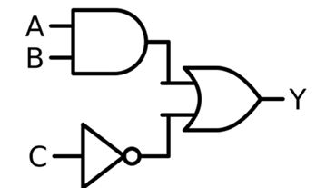
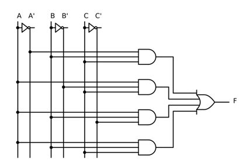
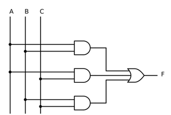

  

# ⚙️ **ÁLGEBRA DE BOOLE Y FORMAS CANÓNICAS** ⚙️

## **🧠 1. De Circuito a Expresión Lógica**

Un circuito digital se traduce directamente a una expresión booleana respetando la precedencia: **`NOT` → `AND` → `OR`**.

- 🔌 **Variables (A, B, C):** Cables de entrada.
- ✖️ **Producto (·):** Compuerta `AND`.
- ➕ **Suma (+):** Compuerta `OR`.
- ⠂ **Complemento ('):** Compuerta `NOT`.

<table width="100%">
  <tr>
    <td width="40%" align="center" valign="middle">
      
    </td>
    <td width="60%" valign="middle">
      <h4><b>Análisis del Circuito:</b></h4>
      <ul>
        <li><code>A</code> y <code>B</code> entran a una compuerta <b>AND</b> &rarr; <code>A · B</code></li>
        <li><code>C</code> entra a un inversor <b>NOT</b> &rarr; <code>C'</code></li>
        <li>Ambas salidas se unen en una compuerta <b>OR</b></li>
      </ul>
      
<b>Expresión Lógica Final:</b> <code>Y = A · B + C'</code>

    </td>
  </tr>
</table>

---

## **📜 2. Postulados de Huntington y Teoremas de Boole**

### **🔄 DUALIDAD**
Si intercambias **`+` por `·`** y **`0` por `1`** (sin cambiar las variables), la expresión sigue siendo totalmente válida.

<table width="100%">
  <thead>
    <tr align="center">
      <th>Postulado / Teorema</th>
      <th>Forma OR (+)</th>
      <th>Forma AND (·) [Dual]</th>
    </tr>
  </thead>
  <tbody>
    <tr align="center">
      <td><b>Identidad</b></td>
      <td>X + 0 = X</td>
      <td>X · 1 = X</td>
    </tr>
    <tr align="center">
      <td><b>Elemento Nulo</b></td>
      <td>X + 1 = 1</td>
      <td>X · 0 = 0</td>
    </tr>
    <tr align="center">
      <td><b>Idempotencia</b></td>
      <td>X + X = X</td>
      <td>X · X = X</td>
    </tr>
    <tr align="center">
      <td><b>Complemento</b></td>
      <td>X + X' = 1</td>
      <td>X · X' = 0</td>
    </tr>
    <tr align="center">
      <td><b>Absorción</b></td>
      <td>X + XY = X</td>
      <td>X(X + Y) = X</td>
    </tr>
    <tr align="center">
      <td><b>Absorción del Complemento</b></td>
      <td>X + X'Y = X + Y</td>
      <td>X(X' + Y) = XY</td>
    </tr>
    <tr align="center">
      <td><b>Adyacencia</b></td>
      <td>XY + XY' = X</td>
      <td>(X + Y)(X + Y') = X</td>
    </tr>
  </tbody>
</table>

---

## **⚡ 3. Leyes de De Morgan**

> 📢 **Regla de oro:** *"Rompe la barra y cambia el operador"*

- `(A · B)' = A' + B'`
- `(A + B)' = A' · B'`

#### **📝 Ejercicios**
<pre><code>1. (A · B · C)' = A' + B' + C'
2. (A + B'C)'   = A' · (B'C)' = A' · (B'' + C') = A' · (B + C')
3. (A'B + C)'   = (A'B)' · C' = (A + B') · C'</code></pre>

---

## **🧩 4. Formas Canónicas: Minitérminos y Maxitérminos**

- 🔴 **Minitérmino (mᵢ):** Representa un **1** en la salida. Se expresa como un **producto** (`AND`). La variable vale 1 sin complementar (`A`) y 0 complementada (`A'`).
- 🔵 **Maxitérmino (Mᵢ):** Representa un **0** en la salida. Se expresa como una **suma** (`OR`). La variable vale 0 sin complementar (`A`) y 1 complementada (`A'`).

<table width="100%">
  <thead>
    <tr align="center">
      <th>i</th>
      <th>A B C</th>
      <th>Minitérmino (mᵢ) - Vale 1</th>
      <th>Maxitérmino (Mᵢ) - Vale 0</th>
    </tr>
  </thead>
  <tbody>
    <tr align="center">
      <td>0</td>
      <td>0 0 0</td>
      <td>A'B'C'</td>
      <td>A + B + C</td>
    </tr>
    <tr align="center">
      <td>1</td>
      <td>0 0 1</td>
      <td>A'B'C</td>
      <td>A + B + C'</td>
    </tr>
    <tr align="center">
      <td>2</td>
      <td>0 1 0</td>
      <td>A'BC'</td>
      <td>A + B' + C</td>
    </tr>
    <tr align="center">
      <td>3</td>
      <td>0 1 1</td>
      <td>A'BC</td>
      <td>A + B' + C'</td>
    </tr>
    <tr align="center">
      <td>4</td>
      <td>1 0 0</td>
      <td>AB'C'</td>
      <td>A' + B + C</td>
    </tr>
    <tr align="center">
      <td>5</td>
      <td>1 0 1</td>
      <td>AB'C</td>
      <td>A' + B + C'</td>
    </tr>
    <tr align="center">
      <td>6</td>
      <td>1 1 0</td>
      <td>ABC'</td>
      <td>A' + B' + C</td>
    </tr>
    <tr align="center">
      <td>7</td>
      <td>1 1 1</td>
      <td>ABC</td>
      <td>A' + B' + C'</td>
    </tr>
  </tbody>
</table>

---

## **🔀 5. SOP vs. POS: Criterio de Elección**

### **🟢 1. SOP (Suma de Productos)**
- **Mira los `1`** de la tabla de verdad.
- Une los minitérminos con sumas (`+`).
- **Sintaxis:** `F = ∑m()`

### **🔵 2. POS (Producto de Sumas)**
- **Mira los `0`** de la tabla de verdad.
- Une los maxitérminos con productos (`·`).
- **Sintaxis:** `F = ∏M(0, 1, 2, 4)`

  💡 <b>Criterio de Elección Técnica:</b>
  <ul>
    <li>Si la tabla tiene <b>pocos 1</b> &rarr; Usar <b>SOP</b> (menos términos).</li>
    <li>Si la tabla tiene <b>pocos 0</b> &rarr; Usar <b>POS</b> (menos términos).</li>
    <li>Para usar compuertas <b>NAND</b> &rarr; Conviene <b>SOP</b> (NAND-NAND / CI 7400).</li>
    <li>Para usar compuertas <b>NOR</b> &rarr; Conviene <b>POS</b> (NOR-NOR / CI 7402).</li>
  </ul>

---

## **🛠️ 6. Caso Práctico: Alarma de Bodega (3 Sensores)**

**Enunciado:** La sirena (`F`) suena si **al menos dos** de los tres sensores (`A, B, C`) se activan.

### **📋 Tabla de Verdad y Simplificación**

<table width="100%">
  <tr>
    <td width="40%" align="center" valign="top">
      <table border="1" cellspacing="0" cellpadding="5" width="100%">
        <thead>
          <tr align="center">
            <th>i</th>
            <th>A</th>
            <th>B</th>
            <th>C</th>
            <th>Salida (F)</th>
          </tr>
        </thead>
        <tbody>
          <tr align="center"><td>0</td><td>0</td><td>0</td><td>0</td><td>0</td></tr>
          <tr align="center"><td>1</td><td>0</td><td>0</td><td>1</td><td>0</td></tr>
          <tr align="center"><td>2</td><td>0</td><td>1</td><td>0</td><td>0</td></tr>
          <tr align="center"><td>3</td><td>0</td><td>1</td><td>1</td><td><b>1</b></td></tr>
          <tr align="center"><td>4</td><td>1</td><td>0</td><td>0</td><td>0</td></tr>
          <tr align="center"><td>5</td><td>1</td><td>0</td><td>1</td><td><b>1</b></td></tr>
          <tr align="center"><td>6</td><td>1</td><td>1</td><td>0</td><td><b>1</b></td></tr>
          <tr align="center"><td>7</td><td>1</td><td>1</td><td>1</td><td><b>1</b></td></tr>
        </tbody>
      </table>
    </td>
    <td width="60%" valign="top">
      <h4><b>Ecuación SOP Canónica:</b></h4>
      <pre><code>F = A'BC + AB'C + ABC' + ABC</code></pre>
      <h4><b>Proceso de Simplificación:</b></h4>
      
Aplicando Idempotencia (duplicar ABC):

      <pre><code>F = (A'BC + ABC) + (AB'C + ABC) + (ABC' + ABC)
F = BC(A' + A)  + AC(B' + B)  + AB(C' + C)
F = BC(1)       + AC(1)       + AB(1)</code></pre>
      <h4><b>Resultado Simplificado:</b></h4>
      <pre><code>F = AB + AC + BC</code></pre>
    </td>
  </tr>
</table>

### **💰 Comparativa de Esquemas y Ahorro en Hardware**

<table width="100%">
  <tr>
    <td width="50%" align="center" valign="top">
      <h4><b>Versión Canónica (Sin simplificar)</b></h4>
      
      
<b>Costo:</b> CI 7404 + 2x CI 7411 + CI 7432 = <b>4 Chips CI</b>

    </td>
    <td width="50%" align="center" valign="top">
      <h4><b>Versión Simplificada</b></h4>
      
      
<b>Costo:</b> CI 7408 + CI 7432 = <b>2 Chips CI</b> (¡50% de ahorro!)

    </td>
  </tr>
</table>

 

  <table border="0" cellspacing="10" cellpadding="10">
    <tr align="center">
      <td bgcolor="#ECEFF1" width="180">
        
      </td>
      <td bgcolor="#E8F5E9" width="160">
        
      </td>
      <td bgcolor="#FFF3E0" width="180">
        
      </td>
    </tr>
  </table>

