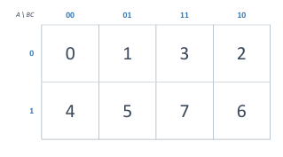
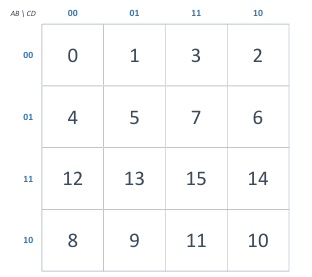
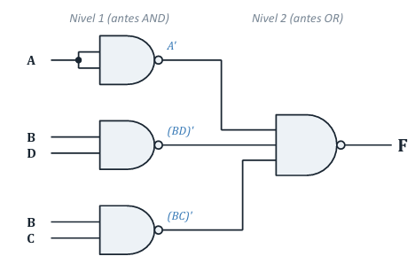

  

# ⚙️ **MAPAS DE KARNAUGH, CONDICIONES INDIFERENTES Y PUERTAS UNIVERSALES** ⚙️

## **🧠 1. El Problema del Mínimo y Adyacencia**

Los **Mapas de Karnaugh (K-Map)** lo resuelven aplicando la regla de adyacencia:

<pre><code>X · Y + X · Y' = X</code></pre>

- **Adyacencia:** Si dos minitérminos vecinos difieren en 1 sola variable, esa variable se elimina.
- **Código Gray:** Los ejes del mapa usan el orden **00, 01, 11, 10** para que las celdas vecinas cambien solo **1 bit** a la vez.

---

## **🗺️ 2. Estructura de los Mapas de Karnaugh**

### **Mapa de 3 Variables (8 Celdas)**

<table width="100%">
  <tr>
    <td width="45%" align="center" valign="middle">
      
    </td>
    <td width="55%" valign="middle">
      <h4><b>Estructura Básica:</b></h4>
      <ul>
        <li><b>Fila (A):</b> 0, 1</li>
        <li><b>Columnas (BC):</b> 00, 01, 11, 10</li>
      </ul>
    </td>
  </tr>
</table>

### **Mapa de 4 Variables (16 Celdas)**

<table width="100%">
  <tr>
    <td width="45%" align="center" valign="middle">
      
    </td>
    <td width="55%" valign="middle">
      <h4><b>Posiciones de Minitérminos:</b></h4>
      <pre><code>00 →  0   1   3   2
01 →  4   5   7   6
11 → 12  13  15  14
10 →  8   9  11  10</code></pre>
      
💡 <b>Bordes Enrollados:</b> Los extremos opuestos y las 4 esquinas son vecinos directos entre sí.

    </td>
  </tr>
</table>

---

## **📏 3. Reglas de Agrupación e Implicantes**

- 📐 **Tamaño 2ᵏ:** Grupos de 1, 2, 4, 8 o 16 celdas. 
- ⏹️ **Forma Rectangular:** Solo rectángulos o cuadrados. 
- 🐘 **Máximo Tamaño:** Entre más grande sea el grupo, más corto queda el término.

### **Tipos de Implicantes:**
- 🔹 **Implicante:** Cualquier grupo válido de `1`s o `X`.
- 🔸 **Implicante Primo:** Grupo que no puede expandirse más.
- ⭐ **Primo Esencial:** Grupo único que cubre a un `1`. 

---

## **🔀 4. Condiciones Indiferentes ('X')**

**Nunca ocurren en la práctica** 

- 🟢 **Usar como 1:** Si ayuda a agrandar un grupo de `1`s.
- 🔴 **Usar como 0:** Si no aporta a la simplificación.
- ⚠️ **Regla:** **Nunca agrupar solo 'X'**.

---

## **🌌 5. Universalidad de Compuertas (NAND y NOR)**

Cualquier circuito lógico se puede construir usando únicamente compuertas NAND o únicamente NOR.

<table width="100%">
  <thead>
    <tr align="center">
      <th>Función Básica</th>
      <th>Equivalencia NAND</th>
      <th>Equivalencia NOR</th>
    </tr>
  </thead>
  <tbody>
    <tr align="center">
      <td><b>NOT</b></td>
      <td>(A · A)'</td>
      <td>(A + A)'</td>
    </tr>
    <tr align="center">
      <td><b>AND</b></td>
      <td>((A · B)')'</td>
      <td>(A' + B')'</td>
    </tr>
    <tr align="center">
      <td><b>OR</b></td>
      <td>(A' · B')'</td>
      <td>((A + B)')'</td>
    </tr>
  </tbody>
</table>

### **Reglas de Conversión Directa:**
- **SOP Mínima** → **NAND-NAND**.
- **POS Mínima** → **NOR-NOR**.

---

### **🔌 Circuito Universal NAND-NAND**

<table width="100%">
  <tr>
    <td width="45%" align="center" valign="middle">
      
    </td>
    <td width="55%" valign="middle">
      <h4><b>Conversión Paso a Paso:</b></h4>
      <ol>
        <li>Simplificado: <code>F = A + BD + BC</code></li>
        <li>Doble Negación: <code>F = ((A + BD + BC)')'</code></li>
        <li>De Morgan: <code>F = (A' · (BD)' · (BC)')'</code></li>
      </ol>
      
<b>Impacto:</b> Pasa de 3 chips variados (7404, 7411, 7432) a solo <b>2 chips de 1 sola familia (7400 + 7410)</b>.

    </td>
  </tr>
</table>

 

  <table border="0" cellspacing="10" cellpadding="10">
    <tr align="center">
      <td bgcolor="#FFF3E0" width="180">
        
      </td>
      <td bgcolor="#E8F5E9" width="160">
        
      </td>
      <td bgcolor="#FCE4EC" width="180">
        
      </td>
    </tr>
  </table>

