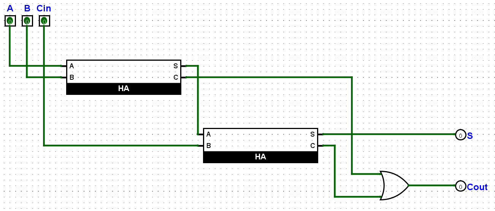
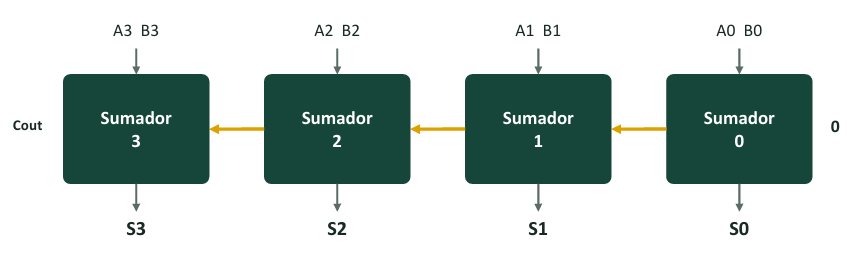
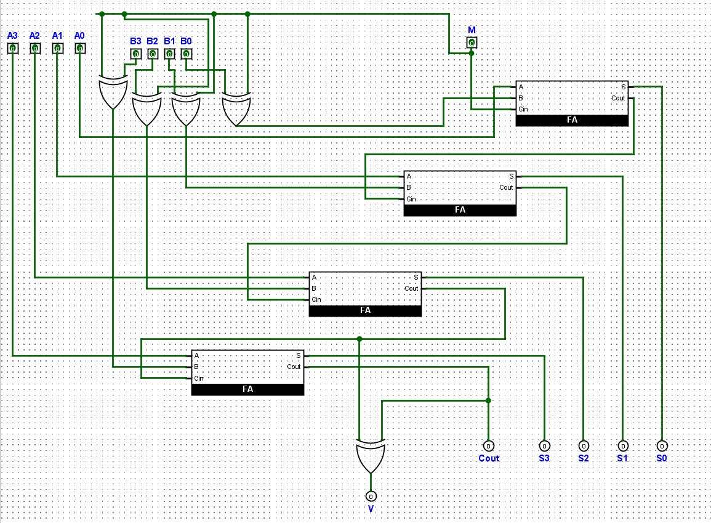

# ⚙️ **CIRCUITOS ARITMÉTICOS: SUMADORES, RESTADORES Y COMPARADORES** ⚙️

## **🧠 1. Suma Binaria y Tipos de Sumadores**

La suma columna por columna requiere dos tipos de circuitos según la posición del bit:

- 🟢 **Semisumador (Half Adder - HA):** Solo suma 2 bits (`A` y `B`). Se usa únicamente en la **columna 0** porque no recibe acarreo previo.
- 🔵 **Sumador Completo (Full Adder - FA):** Suma 3 bits (`A`, `B` y el acarreo de entrada `Cin`). Se usa en las **columnas 1, 2, 3...**

<table width="100%">
  <thead>
    <tr align="center">
      <th>Tipo de Sumador</th>
      <th>Entradas</th>
      <th>Ecuación de Suma (S)</th>
      <th>Ecuación de Acarreo (Cout)</th>
    </tr>
  </thead>
  <tbody>
    <tr align="center">
      <td><b>Semisumador (HA)</b></td>
      <td>A, B</td>
      <td>S = A ⊕ B</td>
      <td>Cout = A · B</td>
    </tr>
    <tr align="center">
      <td><b>Sumador Completo (FA)</b></td>
      <td>A, B, Cin</td>
      <td>S = A ⊕ B ⊕ Cin <i>(Impar de 1s)</i></td>
      <td>Cout = AB + A·Cin + B·Cin <i>(Al menos dos 1s)</i></td>
    </tr>
  </tbody>
</table>

---

## **🗺️ 2. Tablas de Verdad y Mapas de Karnaugh (Full Adder)**

### **📋 Tabla de Verdad del Sumador Completo**

<table width="100%">
  <thead>
    <tr align="center">
      <th>A</th>
      <th>B</th>
      <th>Cin</th>
      <th>N° de 1s</th>
      <th>Acarreo (Cout)</th>
      <th>Suma (S)</th>
    </tr>
  </thead>
  <tbody>
    <tr align="center"><td>0</td><td>0</td><td>0</td><td>0</td><td>0</td><td>0</td></tr>
    <tr align="center"><td>0</td><td>0</td><td>1</td><td>1</td><td>0</td><td><b>1</b></td></tr>
    <tr align="center"><td>0</td><td>1</td><td>0</td><td>1</td><td>0</td><td><b>1</b></td></tr>
    <tr align="center"><td>0</td><td>1</td><td>1</td><td>2</td><td><b>1</b></td><td>0</td></tr>
    <tr align="center"><td>1</td><td>0</td><td>0</td><td>1</td><td>0</td><td><b>1</b></td></tr>
    <tr align="center"><td>1</td><td>0</td><td>1</td><td>2</td><td><b>1</b></td><td>0</td></tr>
    <tr align="center"><td>1</td><td>1</td><td>0</td><td>2</td><td><b>1</b></td><td>0</td></tr>
    <tr align="center"><td>1</td><td>1</td><td>1</td><td>3</td><td><b>1</b></td><td><b>1</b></td></tr>
  </tbody>
</table>

### **🧩 Circuito Esquemático del Sumador Completo**

<table width="100%">
  <tr>
    <td width="40%" align="center" valign="middle">
      
    </td>
    <td width="60%" valign="middle">
      <h4><b>Análisis Ecuacional:</b></h4>
      <ul>
        <li><b>Suma (S):</b> Los 1s forman un patrón en ajedrez (impar de 1s activos) &rarr; <code>S = A ⊕ B ⊕ Cin</code></li>
        <li><b>Acarreo (Cout):</b> Forma 3 grupos de 2 celdas (regla de mayoría) &rarr; <code>Cout = AB + A·Cin + B·Cin</code></li>
      </ul>
    </td>
  </tr>
</table>

---

## **⛓️ 3. Sumador en Cadena (Ripple Carry Adder) y Retardo**

Para sumar números de N bits se encadenan N sumadores completos conectando la salida `Cout` de cada etapa al `Cin` de la siguiente.

<table width="100%">
  <tr>
    <td width="100%" align="center" valign="middle">
      
    </td>
  </tr>
</table>

- 🌊 **Efecto Ola (Ripple):** El resultado final se completa de derecha a izquierda conforme el acarreo se propaga etapa por etapa.
- ⏱️ **Estimación del Retardo:** Asumiendo ≈ 10 ns por compuerta y que el acarreo cruza ≈ 2 compuertas por etapa:

<pre><code>Tiempo Total ≈ 2 · N · 10 ns</code></pre>

- **4 bits:** ≈ 80 ns
- **16 bits:** ≈ 320 ns
- **32 bits:** ≈ 640 ns

---

## **🔄 4. Circuito Sumador / Restador Controlado**

Usando la propiedad de **Complemento a Dos** (`A - B = A + (-B)`) y compuertas `XOR` como inversores controlados por una señal `M`:

<table width="100%">
  <tr>
    <td width="45%" align="center" valign="middle">
      
    </td>
    <td width="55%" valign="middle">
      <h4><b>Modos de Operación:</b></h4>
      <ul>
        <li>🟢 <b>Modo Suma (<code>M = 0</code>):</b> <code>B</code> pasa intacto y <code>Cin = 0</code>.</li>
        <li>🔴 <b>Modo Resta (<code>M = 1</code>):</b> <code>B</code> se invierte bit a bit (<code>XOR</code>) y entra <code>Cin = 1</code> al primer sumador (aporta el +1 de C2).</li>
      </ul>
    </td>
  </tr>
</table>

---

## **⚠️ 5. Overflow (Desbordamiento) y Comparador**

### **🚨 Detección de Overflow (V)**
Ocurre cuando el resultado de una operación con signo supera el rango representable (ejemplo en 4 bits con signo: -8 a +7).

- **Regla Práctica:** Se compara el acarreo que entra al bit de signo (`C3`) con el acarreo que sale (`C4`).

<pre><code>V = C3 ⊕ C4</code></pre>

> 💡 *Nota:* `Cout = 1` en el bit MSB **no** significa error en operaciones con signo; la falla real la indica únicamente el flag `V`.

---

### **📊 Comparador de Magnitud (CI 7485)**

Determina las relaciones de orden entre dos números A y B:

- **Igualdad (`A = B`):** Aplica `XNOR` bit a bit y evalúa una compuerta `AND` general.
- **Mayoría (`A > B`):** Evalúa desde el bit más significativo (MSB) hacia el menos significativo (LSB); el primer bit diferente determina cuál es mayor.
