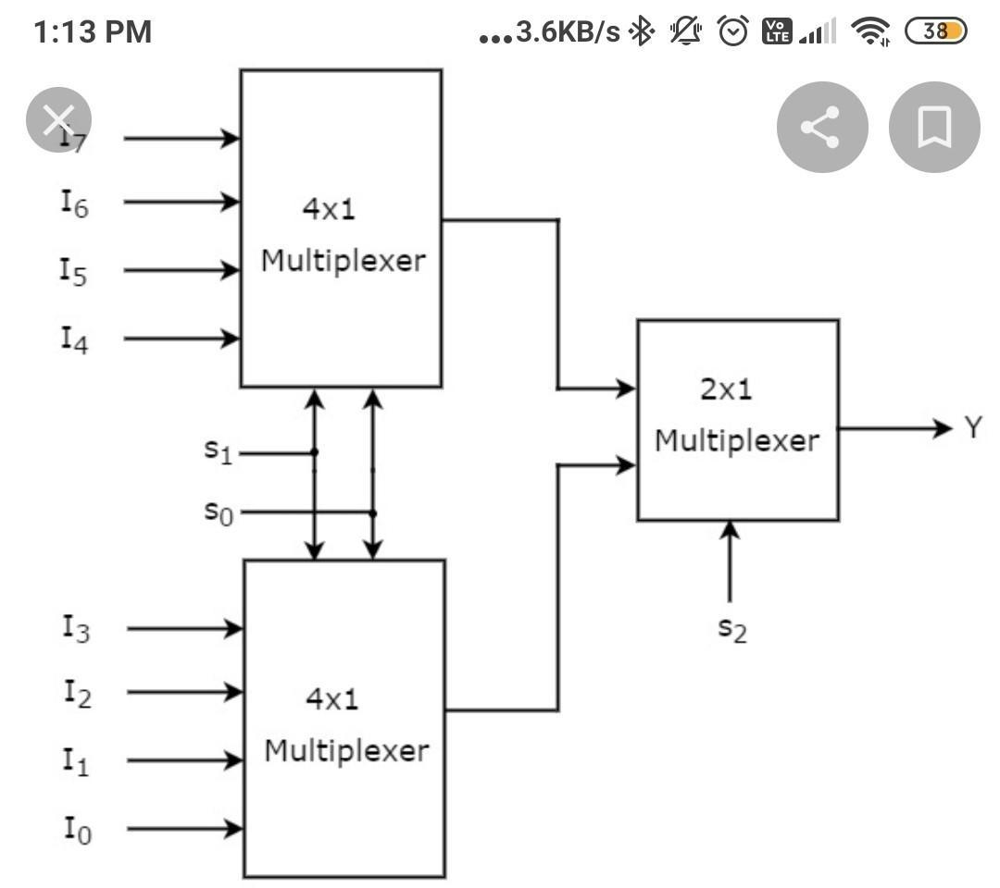
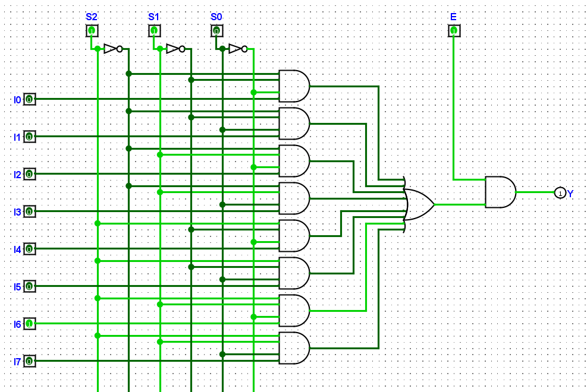
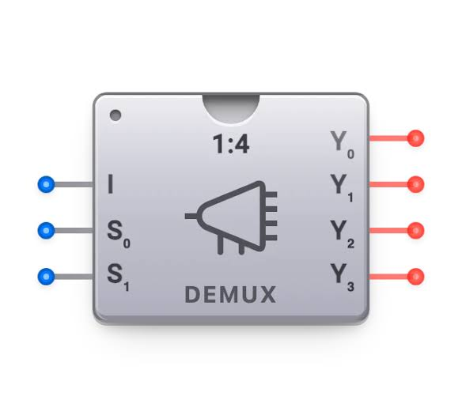
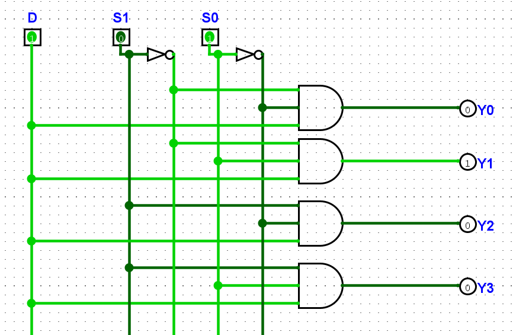
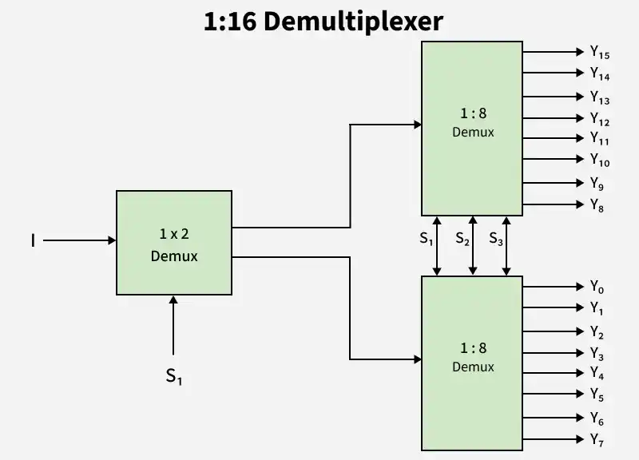
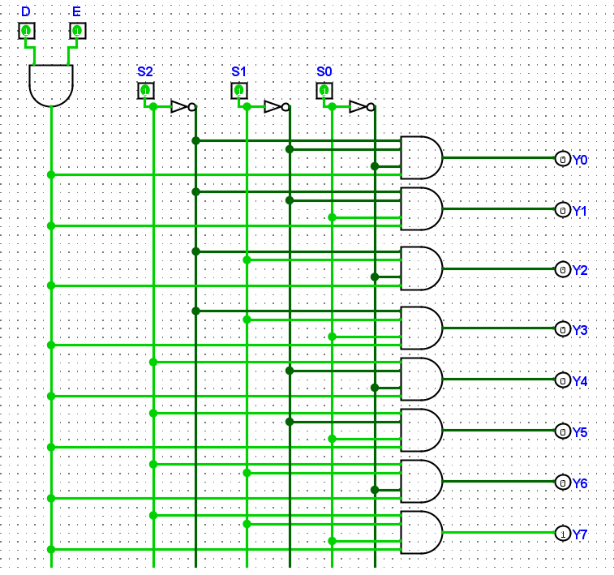
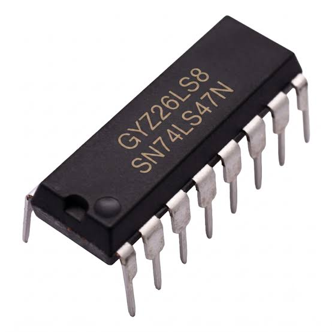
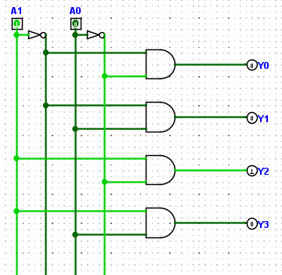
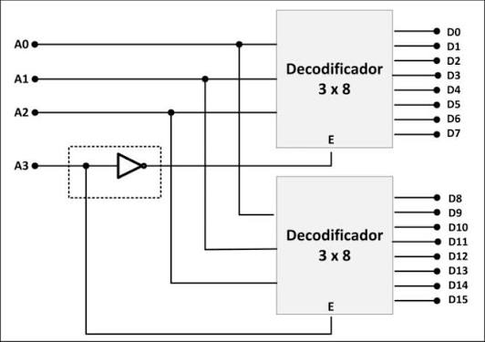
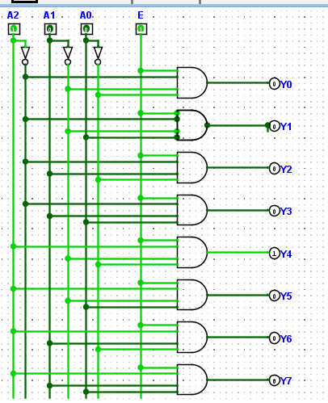

  <h1>⚡ SELECCIÓN Y CODIFICACIÓN DE DATOS ⚡</h1>
  
<i>Unidad 1 • Semana 5 • Diseño de Circuitos Digitales</i>

---

## 🔀 Multiplexor (MUX)

  
  
<em>Figura 1: Multiplexor real.</em>

  <strong style="color: #004c99; font-size: 1.05em;">📘 Definición:</strong> 
  Un multiplexor o selector de datos es aquel que tiene <strong>varias entradas</strong> pero solo <strong>una salida</strong>, es decir, solo deja pasar una de las entradas mediante una selección o control generado por bits (líneas de selección).

---

### 🧩 Partes de un MUX

| 🏷️ Parte | 📖 Explicación | 💡 Ejemplo explicativo |
| :--- | :--- | :--- |
| <strong>📥 2n entradas de datos</strong> | Los datos de entrada solo pueden ser potencias de 2 | <code>23 = 8</code> (I0, I1, I2, I3, I4, I5, I6, I7) |
| <strong>🎛️ n líneas de selección</strong> | De la fórmula 2n que es igual a las entradas, <em>n</em> es la cantidad de bits que controlan la selección | <code>8 = 23</code> por lo tanto <code>n = 3</code>, es decir, habrá tres líneas de selección (3 bits) |
| <strong>📤 1 salida (Y)</strong> | En todo MUX siempre habrá una sola salida | Salida <strong>Y</strong> |
| <strong>🔌 OPCIONAL:</strong> <strong>Entrada de habilitación</strong> | Es una entrada adicional que apaga o enciende el circuito | <ul><li><strong>Si E=1</strong> el MUX funciona de manera normal.</li><li><strong>Si E=0</strong> sin importar las entradas o las líneas de selección la salida (Y) es igual a 0.</li></ul> |

---

***EJEMPLOS:***
 
**MUX 2:1:** Tiene 2 entradas, por lo tanto tiene una línea de control.  

| S | Y |
| :--- | :--- |
| 0 | I0 |
| 1 | I1 |

<pre><code>Y = S' · I0 + S · I1</code></pre>

---

**MUX 4:1:**
Tiene 4 entradas, es decir, 2² por lo tanto n=2 y habrá 2 líneas de selección. 
| S1 | S0 | Y |
| :--- | :--- | :--- |
| 0 | 0 | I0 |
| 0 | 1 | I1 |
| 1 | 0 | I2 |
| 1 | 1 | I3 |

 

<pre><code>Y = S1' · S0' · I0 + S1' · S0 · I1 + S1 · S0' · I2 + S1 · S0 · I3</code></pre>

---

### 🧮 Ecuación Booleana

Para seleccionar una entrada y bloquear las demás se usan las compuertas lógicas **AND** y **OR**. Tomando el ejemplo anterior:

<pre><code>Y = S1' · S0' · I0 + S1' · S0 · I1 + S1 · S0' · I2 + S1 · S0 · I3</code></pre>

  <strong style="color: #4c2889;">⚙️ ¿Cómo funciona la selección?</strong>
  <ul>
    <li><strong>Minitérminos en S:</strong> Esta ecuación representa un minitérmino en <code>S</code> (donde <code>S = 1</code> y <code>S' = 0</code>), y cada combinación de <code>S</code> representa un número binario (<code>00</code>, <code>01</code>, <code>10</code> y <code>11</code>).</li>
    <li><strong>Condición de paso (AND):</strong> Solo deja pasar la entrada cuando la multiplicación (<strong>AND</strong>) entre las líneas de selección es <code>1</code>, ya que así no afecta al valor de la entrada.</li>
    <li><strong>Dependencia de la salida:</strong> Estas combinaciones de <code>S</code> se multiplican (<strong>AND</strong>) con una entrada (<code>I</code>) porque, siempre y cuando las líneas de selección sean iguales a <code>1</code>, el resultado dependerá o será igual a la entrada (<code>I</code>).</li>
  </ul>

#### 📊 Comportamiento de la compuerta AND como llave de paso

| Selección (`S₁ · S₀`) | Entrada (`I`) | Salida (`Y`) | Estado |
| :---: | :---: | :---: | :--- |
| `0` | `0` | `0` | 🔴 Bloqueado (apagado) |
| `0` | `1` | `0` | 🔴 Bloqueado (apagado) |
| `1` | `0` | `0` | 🟢 Pasa el dato `I` (`0`) |
| `1` | `1` | `1` | 🟢 Pasa el dato `I` (`1`) |

---

### Formación de los circuitos 
Siguiendo el ejemplo de del MUX 4:1 se necesitara:  
* 2 NOT (para S₀` y S₁`´).
* 4 AND  de tres entradas.
* 1 OR de 4 entradas.  
***🔢 Integrados de la familia 74LS***  

| Integrado | Qué contiene |
| :--- | :--- |
| 74LS157 | 4 multiplexores 2:1 |
| 74LS153 | 2 multiplexores 4:1 |
| 74LS151 | 1 multiplexor 8:1 |
| 74LS150 | 1 multiplexor 16:1 |
 

  
  
<em>Figura 2: Implementación de un Multiplexor 4:1 con compuertas lógicas (NOT, AND y OR).</em>

En este circuito mediante las líneas de selección se eligió la entrada (01 = 2) que estará en la salida. Y como se puede ver I1 (la segunda entrada) es igual a 1 y Y = 1.   

---

### Expanción 
Un MUX más grande se arma con MUX más chicos. Un MUX 8:1 son dos MUX de 4:1 que comparten S1 y S0 más un MUX 2:1 controlado por S2 que elige cuál de los dos resultados pasa. 

  
  
<em>Figura 3: Expansión de un Multiplexor a 8 entradas (MUX 8:1).</em>

 

  <h3 style="margin: 0; color: #0969da;">⚡ EJERCICIOS ⚡</h3>
  Práctica de Multiplexores (MUX)

 

  <strong style="color: #7d4e00; font-size: 1.05em;">📋 Enunciado:</strong> 
  Una planta industrial requiere supervisar <strong>8 sensores digitales</strong> (<code>I0</code> a <code>I7</code>) enviando su señal a una única línea de monitoreo (<code>Y</code>), controlada por un selector binario y un interruptor maestro de mantenimiento (<code>E</code>). Si los sensores registran <code>I0=0, I1=1, I2=0, I3=1, I4=1, I5=0, I6=1, I7=0</code>, <strong>¿qué arquitectura de multiplexor (dimensionamiento, ecuación, compuertas, integrado comercial y expansión) se requiere, y cuál será el valor en la salida <code>Y</code> cuando <code>S2S1S0 = 110</code> con <code>E = 1</code> y luego al cambiar a <code>E = 0</code>?</strong>

| Parámetro | Valor / Dato |
| :--- | :--- |
| **Tipo de circuito** | MUX 8:1 con Enable |
| **Entradas de datos (2n)** | <code>23 = 8</code> (<code>I0</code> a <code>I7</code>) |
| **Líneas de selección (<em>n</em>)** | <code>n = 3</code> (<code>S2</code>, <code>S1</code>, <code>S0</code>) |
| **Habilitación / Salida** | <code>E</code> (1 bit) / <code>Y</code> (1 salida) |
| **Compuertas discretas** | 3 NOT + 8 AND (4 ent.) + 1 OR (8 ent.) + 1 AND (2 ent.) = **13 compuertas** |
| **Integrado 74LS** | **74LS151** (1 MUX 8:1) |
| **Expansión** | 2 MUX 4:1 (**74LS153**) en <code>S1, S0</code> + 1 MUX 2:1 (**74LS157**) en <code>S2</code> |

 

<pre><code>Y = E · ( S2'·S1'·S0'·I0 + S2'·S1'·S0·I1 + S2'·S1·S0'·I2 + S2'·S1·S0·I3 +
          S2·S1'·S0'·I4 + S2·S1'·S0·I5 + S2·S1·S0'·I6 + S2·S1·S0·I7 )</code></pre>

 

  
  
<em>Figura 4: Simulación en Logisim del Multiplexor 8:1 con entrada de habilitación (E).</em>

| `E` | `S2 S1 S0` | Minitérmino activo (`= 1`) | Canal | Dato (`I`) | Salida (`Y`) |
| :---: | :---: | :---: | :---: | :---: | :---: |
| `1` | `000` | `S2' · S1' · S0'` | `I0` | `0` | `0` |
| `1` | `001` | `S2' · S1' · S0` | `I1` | `1` | `1` |
| `1` | `010` | `S2' · S1 · S0'` | `I2` | `0` | `0` |
| `1` | `011` | `S2' · S1 · S0` | `I3` | `1` | `1` |
| `1` | `100` | `S2 · S1' · S0'` | `I4` | `1` | `1` |
| `1` | `101` | `S2 · S1' · S0` | `I5` | `0` | `0` |
| **`1`** | **`110`** | **`S2 · S1 · S0'`** | **`I6`** | **`1`** | **`1`** |
| `1` | `111` | `S2 · S1 · S0` | `I7` | `0` | `0` |
| **`0`** | **`XXX`** | `0` | — | `X` | **`0`** |

  <strong style="color: #146c43;">✅ Respuesta:</strong> Con <code>E = 1</code> y <code>S2S1S0 = 110</code>, se selecciona <code>I6</code> y la salida es <strong><code>Y = 1</code></strong>; al pasar a <code>E = 0</code>, la salida es <strong><code>Y = 0</code></strong>.

 

---

  ✦ • ✦ • ✦

---

 

---

## 🔀 Demultiplexor (DEMUX)

  
  
<em>Figura 5: Demultiplexor real.</em>

  <strong style="color: #004c99; font-size: 1.05em;">📘 Definición:</strong> 
  
Un demultiplexor hace lo contrario del MUX: toma una sola entrada de datos (D) y la envía a una de varias salidas (la que indica la salida de selección), esta salida toma el valor lógico de la entrada y las demás quedan en 0. 

---

### 🧩 Partes de un DEMUX

| 🏷️ Parte | 📖 Explicación | 💡 Ejemplo explicativo |
| :--- | :--- | :--- |
| <strong>📥 1 entrada de datos (D)</strong> | En todo DEMUX siempre habrá una sola entrada de datos, que es la señal que se quiere repartir | Entrada <strong>D</strong> |
| <strong>🎛️ n líneas de selección</strong> | Son los bits que indican por cuál salida debe salir el dato. Si hay 2n salidas, <em>n</em> es la cantidad de bits de selección | <code>8 = 23</code> por lo tanto <code>n = 3</code>, es decir, habrá tres líneas de selección (3 bits) |
| <strong>📤 2n salidas</strong> | La cantidad de salidas es una potencia de 2. Solo una toma el valor de D y las demás quedan en 0 | <code>23 = 8</code> (Y0, Y1, Y2, Y3, Y4, Y5, Y6, Y7) |
| <strong>🔌 OPCIONAL:</strong> <strong>Entrada de habilitación</strong> | Es una entrada adicional que apaga o enciende el circuito | <ul><li><strong>Si E=1</strong> el DEMUX funciona de manera normal.</li><li><strong>Si E=0</strong> sin importar D ni las líneas de selección, todas las salidas (Y) valen 0.</li></ul> |

 

---

***Ejemplo***  
**DEMUX 1:4**  
| S1 | S0 | Y0 | Y1 | Y2 | Y3 |
| :--- | :--- | :--- | :--- | :--- | :--- |
| 0 | 0 | D | 0 | 0 | 0 |
| 0 | 1 | 0 | D | 0 | 0 |
| 1 | 0 | 0 | 0 | D | 0 |
| 1 | 1 | 0 | 0 | 0 | D |

 

<pre><code>Y0 = D · S1' · S0'      Y1 = D · S1' · S0      Y2 = D · S1 · S0'      Y3 = D · S1 · S0</code></pre>

 

---

### 🧮 Ecuación Booleana

Para enviar el dato a una sola salida y dejar las demás en 0 también se usan compuertas **AND**, pero aquí **no lleva OR**, porque cada salida es independiente. Tomando el ejemplo anterior (DEMUX 1:4):

<pre><code>Y0 = D · S1' · S0'
Y1 = D · S1' · S0
Y2 = D · S1 · S0'
Y3 = D · S1 · S0</code></pre>

  <strong style="color: #4c2889;">⚙️ ¿Cómo funciona la selección?</strong>
  <ul>
    <li><strong>Minitérminos en S:</strong> Cada ecuación contiene un minitérmino en <code>S</code> (donde <code>S = 1</code> y <code>S' = 0</code>), y cada combinación de <code>S</code> representa un número binario (<code>00</code>, <code>01</code>, <code>10</code> y <code>11</code>) que corresponde a una salida (<code>Y0</code>, <code>Y1</code>, <code>Y2</code> y <code>Y3</code>).</li>
    <li><strong>Condición de paso (AND):</strong> El dato <code>D</code> solo llega a la salida cuando el minitérmino de <code>S</code> vale <code>1</code>, ya que así la multiplicación (<strong>AND</strong>) no cambia el valor de <code>D</code>.</li>
    <li><strong>Salidas bloqueadas:</strong> En las demás salidas el minitérmino de <code>S</code> vale <code>0</code>, y como cualquier cosa multiplicada por <code>0</code> da <code>0</code>, esas salidas quedan apagadas sin importar el valor de <code>D</code>.</li>
  </ul>

#### 📊 Comportamiento de la compuerta AND como llave de paso

| Minitérmino de S (`1` = seleccionado) | Dato (`D`) | Salida (`Y`) | Estado |
| :---: | :---: | :---: | :--- |
| `0` | `0` | `0` | 🔴 Bloqueado (apagado) |
| `0` | `1` | `0` | 🔴 Bloqueado (apagado) |
| `1` | `0` | `0` | 🟢 Pasa el dato `D` (`0`) |
| `1` | `1` | `1` | 🟢 Pasa el dato `D` (`1`) |

#### 🧪 Ejemplo numérico

Con `D = 1` y `S₁ S₀ = 10` (que es 2 en decimal):

| Salida | Cálculo | Resultado |
| :---: | :--- | :---: |
| `Y0` | `1 · 1 · 0 = 0` | `0` |
| `Y1` | `1 · 1 · 1 · ... ` | `0` |
| `Y2` | `1 · 1 · 1 = 1` | `1` ✅ |
| `Y3` | `1 · 1 · 0 = 0` | `0` |

El dato `D` sale únicamente por **Y2**. Si `D = 0`, todas las salidas valen `0`.

---

### 🔧 Formación del circuito

Siguiendo el ejemplo del DEMUX 1:4 se necesitará:

* 2 NOT (para S₁' y S₀').
* 4 AND de tres entradas (una por cada salida).

Total: **6 compuertas**.  

***🔢 Integrados de la familia 74LS***  
| Integrado | Qué contiene |
| :--- | :--- |
| 74LS139 | 2 demultiplexores 1:4  |
| 74LS155 | 2 demultiplexores 1:4 |
| 74LS138 | 1 demultiplexor 1:8 |
| 74LS154 | 1 demultiplexor 1:16 |

 

  
  
<em>Figura 6: Implementación de un Demultiplexor 1:4 con compuertas lógicas (NOT y AND).</em>

---

### 🔧 Expansión

Un DEMUX más grande se arma con DEMUX más chicos. Un **DEMUX 1:16** es un **DEMUX 1:2** controlado por **S3**, que decide cuál de los dos DEMUX 1:8 recibe el dato **D**, más dos **DEMUX 1:8** que comparten **S2, S1 y S0**.

  
  
<em>Figura 7: Demultiplexor 1:4.</em>

> **Nota sobre la figura:** en la imagen original las líneas de selección están rotuladas S1, S2, S3 y S1. En este cuaderno se leen así: **S3** controla el DEMUX 1x2, y **S2, S1 y S0** se comparten con los dos DEMUX 1:8. La entrada **I** de la figura es la entrada **D**.

| S3 | S2 S1 S0 | DEMUX 1:8 que recibe D | Salida que toma el valor de D |
| :---: | :---: | :---: | :---: |
| 0 | 000 a 111 | Inferior | Y0 a Y7 |
| 1 | 000 a 111 | Superior | Y8 a Y15 |

El DEMUX 1:8 que **no** es elegido recibe 0, así que todas sus salidas quedan en 0.

**Ejemplo:** con S3 S2 S1 S0 = 1010 (que es 10 en decimal), el dato sale por **Y10**.

 

  <h3 style="margin: 0; color: #0969da;">⚡ EJERCICIOS ⚡</h3>
  Práctica de Demultiplexores (DEMUX)

 

  <strong style="color: #7d4e00; font-size: 1.05em;">📋 Enunciado:</strong> 
  Un sistema de distribución automatizado recibe una señal única de control (<code>D</code>) desde un microcontrolador y debe enrutarla hacia <strong>8 actuadores independientes</strong> (<code>Y0</code> a <code>Y7</code>), gobernados por un selector binario de 3 bits y un botón maestro de seguridad (<code>E</code>). Si se envía el dato <code>D = 1</code> con el interruptor maestro activo (<code>E = 1</code>), <strong>¿qué arquitectura de demultiplexor (dimensionamiento, ecuaciones booleanas, compuertas, integrado comercial y expansión) se requiere, y cuál será el estado en las 8 salidas cuando <code>S2S1S0 = 101</code> y luego al desactivar <code>E = 0</code>?</strong>

| Parámetro | Valor / Dato |
| :--- | :--- |
| **Tipo de circuito** | DEMUX 1:8 con Enable |
| **Entrada de datos** | `D` (1 línea única de información) |
| **Líneas de selección (<em>n</em>)** | <code>n = 3</code> (<code>S2</code>, <code>S1</code>, <code>S0</code>) |
| **Salidas de datos (2n)** | <code>23 = 8</code> (<code>Y0</code> a <code>Y7</code>) |
| **Habilitación** | `E` (1 bit de control maestro) |
| **Compuertas discretas** | 3 NOT + 8 AND (5 ent.: `D`, `E`, `S2`, `S1`, `S0`) = **11 compuertas** *(sin OR)* |
| **Integrado 74LS** | **74LS138** (Decodificador/DEMUX 1:8 usando Enable como entrada de datos) |
| **Expansión** | 1 DEMUX 1:2 en `S2` + 2 DEMUX 1:4 (**74LS139**) compartiendo `S1, S0` |

 

<pre><code>Y0 = E · D · S2' · S1' · S0'       Y4 = E · D · S2 · S1' · S0'
Y1 = E · D · S2' · S1' · S0        Y5 = E · D · S2 · S1' · S0
Y2 = E · D · S2' · S1 · S0'        Y6 = E · D · S2 · S1 · S0'
Y3 = E · D · S2' · S1 · S0         Y7 = E · D · S2 · S1 · S0</code></pre>

 

  
  
<em>Figura 8: Simulación en Logisim del Demultiplexor 1:8 con entrada de habilitación (E).</em>

| `E` | `D` | `S2 S1 S0` | Canal activo | `Y0` | `Y1` | `Y2` | `Y3` | `Y4` | `Y5` | `Y6` | `Y7` |
| :---: | :---: | :---: | :---: | :---: | :---: | :---: | :---: | :---: | :---: | :---: | :---: |
| `1` | `1` | `000` | `Y0` | `1` | `0` | `0` | `0` | `0` | `0` | `0` | `0` |
| `1` | `1` | `001` | `Y1` | `0` | `1` | `0` | `0` | `0` | `0` | `0` | `0` |
| `1` | `1` | `010` | `Y2` | `0` | `0` | `1` | `0` | `0` | `0` | `0` | `0` |
| `1` | `1` | `011` | `Y3` | `0` | `0` | `0` | `1` | `0` | `0` | `0` | `0` |
| `1` | `1` | `100` | `Y4` | `0` | `0` | `0` | `0` | `1` | `0` | `0` | `0` |
| **`1`** | **`1`** | **`101`** | **`Y5`** | **`0`** | **`0`** | **`0`** | **`0`** | **`0`** | **`1`** | **`0`** | **`0`** |
| `1` | `1` | `110` | `Y6` | `0` | `0` | `0` | `0` | `0` | `0` | `1` | `0` |
| `1` | `1` | `111` | `Y7` | `0` | `0` | `0` | `0` | `0` | `0` | `0` | `1` |
| **`0`** | **`X`** | **`XXX`** | *Ninguno* | **`0`** | **`0`** | **`0`** | **`0`** | **`0`** | **`0`** | **`0`** | **`0`** |

  <strong style="color: #146c43;">✅ Respuesta:</strong> Con <code>E = 1</code>, <code>D = 1</code> y <code>S2S1S0 = 101</code>, el dato se enruta únicamente hacia la salida <strong><code>Y5 = 1</code></strong> mientras las demás quedan en <code>0</code>; al desactivar <code>E = 0</code>, <strong>todas las salidas (<code>Y0</code> a <code>Y7</code>) pasan a <code>0</code></strong>.

 

---

  ✦ • ✦ • ✦

---

 

## 🔓 Decodificador (Decoder)

  
  
<em>Figura 9: Decodificador real (familia 74LS).</em>

  <strong style="color: #004c99; font-size: 1.05em;">📘 Definición:</strong> 
  Un decodificador es un circuito combinacional que funciona como un traductor de binario a señales individuales: recibe un <strong>código binario corto de <em>n</em> bits</strong> en sus entradas y activa <strong>una única línea específica</strong> entre <strong>2n salidas posibles</strong>, manteniendo todas las demás apagadas. A diferencia del DEMUX, no tiene un cable de datos que repartir; su único trabajo es leer la combinación binaria y encender el canal exacto que le corresponde.

---

### 🧩 Partes de un Decodificador

| 🏷️ Parte | 📖 Explicación | 💡 Ejemplo explicativo |
| :--- | :--- | :--- |
| <strong>🎛️ n entradas de código</strong> | Son los pines por donde entra el número binario que indica qué salida encender | <code>n = 3</code> líneas de entrada (<code>A2</code>, <code>A1</code>, <code>A0</code>) |
| <strong>📤 2n salidas individuales</strong> | Cada combinación binaria en la entrada enciende una única salida distinta | <code>23 = 8</code> salidas (<code>Y0</code> a <code>Y7</code>) |
| <strong>🔌 OPCIONAL:</strong> <strong>Habilitación (Enable)</strong> | Pin maestro que enciende o apaga todo el circuito. *(Si se usa como entrada de datos, el decodificador funciona igual que un DEMUX)* | <ul><li><strong>Si E=1</strong> decodifica normalmente el código de entrada.</li><li><strong>Si E=0</strong> todas las salidas permanecen apagadas sin importar el código.</li></ul> |

---

***EJEMPLOS:***
 
**Decodificador 2:4 (2 a 4):** Tiene 2 entradas binarias ($n = 2$), por lo tanto activa 1 de $2^2 = 4$ salidas posibles. 

| A1 | A0 | Y0 | Y1 | Y2 | Y3 |
| :---: | :---: | :---: | :---: | :---: | :---: |
| 0 | 0 | **1** | 0 | 0 | 0 |
| 0 | 1 | 0 | **1** | 0 | 0 |
| 1 | 0 | 0 | 0 | **1** | 0 |
| 1 | 1 | 0 | 0 | 0 | **1** |

 

<pre><code>Y0 = A1' · A0'       Y1 = A1' · A0       Y2 = A1 · A0'       Y3 = A1 · A0</code></pre>

---

### 🧮 Ecuaciones Booleanas y Lógica Interna

Para que cada salida reconozca únicamente su número binario correspondiente, se usan **compuertas NOT** (para invertir los ceros) y **compuertas AND** (una por cada salida).

  <strong style="color: #4c2889;">⚙️ ¿Cómo funciona la decodificación?</strong>
  <ul>
    <li><strong>Un minitérmino por salida:</strong> Cada salida tiene su propia compuerta AND conectada a una combinación única de entradas directas y negadas.</li>
    <li><strong>Exclusividad:</strong> Como solo una combinación binaria puede existir en las entradas al mismo tiempo, únicamente una compuerta AND cumple con tener todas sus entradas en <code>1</code>.</li>
    <li><strong>Salidas activas en bajo (Active-Low):</strong> En los chips comerciales 74LS se usan compuertas <strong>NAND</strong> en lugar de AND; por eso, la salida seleccionada marca <code>0</code> mientras las demás se quedan en <code>1</code>.</li>
  </ul>

#### 📊 Tipos especiales: Decodificador BCD a 7 Segmentos

Además de encender una sola línea, existen decodificadores diseñados para pantallas numéricas. Reciben un **código BCD** de 4 bits (dígitos del `0` al `9`) y encienden **varios segmentos a la vez** (`a, b, c, d, e, f, g`) para dibujar el número en un display.

| Dígito Decimal | Código BCD (`D C B A`) | Segmentos encendidos | Visualización |
| :---: | :---: | :---: | :--- |
| **`0`** | `0000` | `a, b, c, d, e, f` | Forma el número **0** |
| **`1`** | `0001` | `b, c` | Forma el número **1** |
| **`5`** | `0101` | `a, f, g, c, d` | Forma el número **5** |
| **`8`** | `1000` | `a, b, c, d, e, f, g` | Forma el número **8** |

---

### Formación de los circuitos
Siguiendo el ejemplo del Decodificador 2:4 (sin Enable) se necesitará: 
- 2 NOT (para `A0'` y `A1'`).
- 4 AND de 2 entradas (una para cada salida `Y0` a `Y3`). *(Nota: Aquí no se usa compuerta OR porque cada salida es independiente).* 

***🔢 Integrados de la familia 74LS*** 

| Integrado | Qué contiene | Tipo de salida |
| :--- | :--- | :--- |
| **74LS139** | 2 decodificadores 2:4 independientes | Activa en bajo (`0`) |
| **74LS138** | 1 decodificador 3:8 (con 3 pines Enable) | Activa en bajo (`0`) |
| **74LS154** | 1 decodificador 4:16 | Activa en bajo (`0`) |
| **74LS47** | Decodificador BCD a 7 segmentos (Ánodo común) | Activa en bajo (`0`) |
| **74LS48** | Decodificador BCD a 7 segmentos (Cátodo común) | Activa en alto (`1`) |

 

  
  
<em>Figura 10: Implementación de un Decodificador 2:4 con compuertas lógicas (NOT y AND).</em>

En este circuito, al ingresar el código binario `10` (`A1 = 1, A0 = 0`), únicamente se cumple la condición de la tercera compuerta AND y se enciende la salida `Y2 = 1`. 

---

### Expansión
Para formar un decodificador más grande se conectan varios decodificadores pequeños usando sus pines de habilitación (**Enable**). Por ejemplo, un **Decodificador 3:8** se arma con **dos decodificadores 2:4** que comparten `A1` y `A0`, mientras el bit más significativo (`A2`) habilita el primer bloque cuando vale `0` (salidas `Y0`–`Y3`) y el segundo bloque cuando vale `1` (salidas `Y4`–`Y7`).

  
  
<em>Figura 11: Expansión de dos Decodificadores 2:4 para formar un Decodificador 3:8.</em>

 

  <h3 style="margin: 0; color: #0969da;">⚡ EJERCICIOS ⚡</h3>
  Práctica de Decodificadores (Decoder)

 

  <strong style="color: #7d4e00; font-size: 1.05em;">📋 Enunciado:</strong> 
  Un sistema de almacenamiento automatizado cuenta con <strong>8 compartimentos de seguridad</strong> (<code>Y0</code> a <code>Y7</code>) y necesita abrir exactamente uno a la vez según el código de 3 bits enviado desde un panel de control (<code>A2A1A0</code>), contando además con una llave maestra de encendido (<code>E</code>). <strong>¿Qué arquitectura de decodificador (dimensionamiento, ecuaciones, compuertas, integrado comercial y expansión) se requiere, y qué compartimento se abrirá cuando se envíe <code>A2A1A0 = 100</code> con <code>E = 1</code> y luego al girar la llave a <code>E = 0</code>?</strong>

| Parámetro | Valor / Dato |
| :--- | :--- |
| **Tipo de circuito** | Decodificador 3:8 con Enable (activo en alto) |
| **Entradas de código (<em>n</em>)** | <code>n = 3</code> (<code>A2</code>, <code>A1</code>, <code>A0</code>) |
| **Salidas individuales (2n)** | <code>23 = 8</code> (<code>Y0</code> a <code>Y7</code>) |
| **Habilitación** | <code>E</code> (1 bit maestro) |
| **Compuertas discretas** | 3 NOT + 8 AND (4 ent.: `E`, `A2`, `A1`, `A0`) = **11 compuertas** |
| **Integrado 74LS** | **74LS138** (1 decodificador 3:8, salidas activas en bajo) |
| **Expansión** | 2 decodificadores 2:4 (**74LS139**) compartiendo <code>A1, A0</code> + 1 NOT en <code>A2</code> |

 

<pre><code>Y0 = E · A2' · A1' · A0'       Y4 = E · A2 · A1' · A0'
Y1 = E · A2' · A1' · A0        Y5 = E · A2 · A1' · A0
Y2 = E · A2' · A1 · A0'        Y6 = E · A2 · A1 · A0'
Y3 = E · A2' · A1 · A0         Y7 = E · A2 · A1 · A0</code></pre>

 

  
  
<em>Figura 12: Simulación en Logisim del Decodificador 3:8 con entrada de habilitación (E).</em>

| `E` | `A2 A1 A0` | Minitérmino activo (`= 1`) | `Y0` | `Y1` | `Y2` | `Y3` | `Y4` | `Y5` | `Y6` | `Y7` | Salida activa |
| :---: | :---: | :---: | :---: | :---: | :---: | :---: | :---: | :---: | :---: | :---: | :---: |
| `1` | `000` | `A2' · A1' · A0'` | `1` | `0` | `0` | `0` | `0` | `0` | `0` | `0` | `Y0` |
| `1` | `001` | `A2' · A1' · A0` | `0` | `1` | `0` | `0` | `0` | `0` | `0` | `0` | `Y1` |
| `1` | `010` | `A2' · A1 · A0'` | `0` | `0` | `1` | `0` | `0` | `0` | `0` | `0` | `Y2` |
| `1` | `011` | `A2' · A1 · A0` | `0` | `0` | `0` | `1` | `0` | `0` | `0` | `0` | `Y3` |
| **`1`** | **`100`** | **`A2 · A1' · A0'`** | **`0`** | **`0`** | **`0`** | **`0`** | **`1`** | **`0`** | **`0`** | **`0`** | **`Y4`** |
| `1` | `101` | `A2 · A1' · A0` | `0` | `0` | `0` | `0` | `0` | `1` | `0` | `0` | `Y5` |
| `1` | `110` | `A2 · A1 · A0'` | `0` | `0` | `0` | `0` | `0` | `0` | `1` | `0` | `Y6` |
| `1` | `111` | `A2 · A1 · A0` | `0` | `0` | `0` | `0` | `0` | `0` | `0` | `1` | `Y7` |
| **`0`** | **`XXX`** | `0` | **`0`** | **`0`** | **`0`** | **`0`** | **`0`** | **`0`** | **`0`** | **`0`** | *Ninguna* |

  <strong style="color: #146c43;">✅ Respuesta:</strong> Con <code>E = 1</code> y <code>A2A1A0 = 100</code>, se activa únicamente el compartimento <strong><code>Y4 = 1</code></strong> mientras los demás quedan en <code>0</code>; al girar la llave a <code>E = 0</code>, <strong>todas las salidas pasan a <code>0</code></strong> y ningún compartimento se abre.

 

---

  ✦ • ✦ • ✦

---

## 🔐 Codificador (Encoder)

  
  
<em>Figura 13: Codificador real (familia 74LS).</em>

  <strong style="color: #004c99; font-size: 1.05em;">📘 Definición:</strong> 
  Un codificador es un circuito combinacional que hace exactamente el trabajo inverso al decodificador: recibe <strong>varias señales individuales de entrada (2n)</strong> donde solo una se activa a la vez, y las resume en un <strong>código binario compacto de <em>n</em> bits</strong> en sus salidas. Su función principal es ahorrar líneas de conexión convirtiendo pulsaciones o señales independientes (como las teclas de un teclado) en unos y ceros que otro circuito pueda procesar.

---

### 🧩 Partes de un Codificador

| 🏷️ Parte | 📖 Explicación | 💡 Ejemplo explicativo |
| :--- | :--- | :--- |
| <strong>📥 2n entradas individuales</strong> | Líneas independientes que representan cada opción o tecla disponible | <code>23 = 8</code> entradas (<code>I0</code> a <code>I7</code>) |
| <strong>📤 n salidas de código</strong> | Pines que entregan el número binario correspondiente a la entrada activa | <code>n = 3</code> bits de salida (<code>Y2</code>, <code>Y1</code>, <code>Y0</code>) |
| <strong>👑 Prioridad (Priority Encoder)</strong> | Función integrada en chips comerciales que decide cuál salida generar si se activan dos entradas al mismo tiempo (atiende siempre a la de mayor número) | Si se presionan <code>I2</code> e <code>I5</code> juntas, entrega el binario de <code>5</code> (<code>101</code>) |

---

***EJEMPLOS:***
 
**Codificador 4:2 (4 a 2):** Tiene $2^2 = 4$ entradas individuales (`I0` a `I3`), por lo tanto entrega un código binario de $n = 2$ bits (`Y1, Y0`). 

| `I3` | `I2` | `I1` | `I0` | `Y1` | `Y0` | Código generado |
| :---: | :---: | :---: | :---: | :---: | :---: | :--- |
| `0` | `0` | `0` | **`1`** | `0` | `0` | `00` (Entrada `I0`) |
| `0` | `0` | **`1`** | `0` | `0` | `1` | `01` (Entrada `I1`) |
| `0` | **`1`** | `0` | `0` | `1` | `0` | `10` (Entrada `I2`) |
| **`1`** | `0` | `0` | `0` | `1` | `1` | `11` (Entrada `I3`) |

 

<pre><code>Y1 = I2 + I3           Y0 = I1 + I3</code></pre>

---

### 🧮 Ecuaciones Booleanas y Lógica Interna

A diferencia del decodificador (que usa compuertas NOT y AND), un codificador básico se construye únicamente con **compuertas OR**. Cada bit de salida se enciende cuando se activa cualquiera de las entradas que llevan un `1` en esa posición binaria.

  <strong style="color: #4c2889;">⚙️ ¿Cómo se obtienen las ecuaciones?</strong>
  <ul>
    <li><strong>Bit Y0 (peso 1):</strong> Debe valer <code>1</code> para los números impares (<code>I1 = 01</code> e <code>I3 = 11</code>), por eso se suman con una OR: <code>Y0 = I1 + I3</code>.</li>
    <li><strong>Bit Y1 (peso 2):</strong> Debe valer <code>1</code> para los números mayores o iguales a 2 (<code>I2 = 10</code> e <code>I3 = 11</code>), por eso: <code>Y1 = I2 + I3</code>.</li>
    <li><strong>Entrada I0 sin conexión:</strong> Cuando solo <code>I0</code> está en <code>1</code>, ambas compuertas OR reciben <code>0</code> y la salida marca automáticamente <code>00</code>.</li>
  </ul>

#### 📊 Tipos especiales: Codificador de Prioridad y BCD

En la práctica pueden ocurrir dos pulsaciones accidentales al mismo tiempo. Para evitar errores, los integrados reales incorporan **lógica de prioridad** (gana la entrada de mayor índice) y salidas de validación (`GS` o `EO`).

| Tipo de Codificador | Entradas $\rightarrow$ Salidas | Uso principal |
| :--- | :---: | :--- |
| **Binario estándar (8:3)** | `8` líneas $\rightarrow$ `3` bits | Conversión directa de 8 canales a binario natural (`000`–`111`) |
| **Decimal a BCD (10:4)** | `10` teclas (`0`–`9`) $\rightarrow$ `4` bits | Teclados numéricos que entregan código BCD `8421` (`0000`–`1001`) |

---

### Formación de los circuitos
Siguiendo el ejemplo del Codificador 4:2 básico se necesitará: 
- 0 NOT y 0 AND.
- 2 compuertas OR de 2 entradas (una para `Y1` y otra para `Y0`). 

***🔢 Integrados de la familia 74LS*** 

| Integrado | Qué contiene | Característica |
| :--- | :--- | :--- |
| **74LS148** | Codificador de prioridad **8:3** (octal a binario) | Entradas y salidas activas en bajo (`0`), permite expansión |
| **74LS147** | Codificador de prioridad **10:4** (decimal a BCD) | Convierte 9 líneas activas (`1`–`9`) a BCD invertido (`0000` es reposo) |

 

  
  
<em>Figura 14: Implementación de un Codificador 4:2 con compuertas lógicas (OR).</em>

En este circuito, al activar únicamente la entrada `I2 = 1` (tercera línea), la compuerta superior (`Y1`) recibe un `1` mientras la inferior (`Y0`) recibe `0`, generando en la salida el código binario `10` (2 en decimal). 

---

### Expansión
Para ampliar un codificador (por ejemplo, unir **dos codificadores de prioridad 8:3** como el **74LS148** para formar un **Codificador 16:4**), se conecta la salida de habilitación (`EO`) del chip de mayor prioridad hacia la entrada de habilitación (`EI`) del chip de menor prioridad. De esta forma, si se activa cualquier entrada en el bloque superior (`I8`–`I15`), este bloquea automáticamente al bloque inferior (`I0`–`I7`) y activa el cuarto bit de salida (`Y3 = 1`).

  
  
<em>Figura 15: Expansión en cascada de dos Codificadores de prioridad 8:3 para formar un Codificador 16:4.</em>

 

  <h3 style="margin: 0; color: #0969da;">⚡ EJERCICIOS ⚡</h3>
  Práctica de Codificadores (Encoder)

 

  <strong style="color: #7d4e00; font-size: 1.05em;">📋 Enunciado:</strong> 
  Una central de alarmas industriales supervisa <strong>8 zonas independientes</strong> (<code>I0</code> a <code>I7</code>) y debe enviar hacia una pantalla central un código binario de 3 bits (<code>Y2Y1Y0</code>) que identifique qué zona activó su sensor. <strong>¿Qué arquitectura de codificador (dimensionamiento, ecuaciones booleanas, compuertas e integrado comercial) se necesita, y cuál será el código binario entregado en <code>Y2Y1Y0</code> si se dispara únicamente el sensor de la zona <code>I5 = 1</code>?</strong>

| Parámetro | Valor / Dato |
| :--- | :--- |
| **Tipo de circuito** | Codificador binario 8:3 |
| **Entradas individuales (2n)** | <code>23 = 8</code> zonas (<code>I0</code> a <code>I7</code>) |
| **Salidas de código (<em>n</em>)** | <code>n = 3</code> bits (<code>Y2</code>, <code>Y1</code>, <code>Y0</code>) |
| **Compuertas discretas** | **3 compuertas OR** de 4 entradas cada una (una por cada bit de salida) |
| **Integrado 74LS** | **74LS148** (codificador de prioridad 8:3, entradas/salidas activas en bajo) |
| **Expansión** | Conexión en cascada (<code>EO</code> $\rightarrow$ <code>EI</code>) de dos **74LS148** para 16 zonas (<code>16:4</code>) |

 

<pre><code>Y2 = I4 + I5 + I6 + I7
Y1 = I2 + I3 + I6 + I7
Y0 = I1 + I3 + I5 + I7</code></pre>

 

  
  
<em>Figura 16: Simulación en Logisim del Codificador 8:3 con compuertas OR.</em>

| Entrada activa (`= 1`) | `I7` | `I6` | `I5` | `I4` | `I3` | `I2` | `I1` | `I0` | `Y2` | `Y1` | `Y0` | Código binario |
| :---: | :---: | :---: | :---: | :---: | :---: | :---: | :---: | :---: | :---: | :---: | :---: | :---: |
| `I0` | `0` | `0` | `0` | `0` | `0` | `0` | `0` | `1` | `0` | `0` | `0` | `000` |
| `I1` | `0` | `0` | `0` | `0` | `0` | `0` | `1` | `0` | `0` | `0` | `1` | `001` |
| `I2` | `0` | `0` | `0` | `0` | `0` | `1` | `0` | `0` | `0` | `1` | `0` | `010` |
| `I3` | `0` | `0` | `0` | `0` | `1` | `0` | `0` | `0` | `0` | `1` | `1` | `011` |
| `I4` | `0` | `0` | `0` | `1` | `0` | `0` | `0` | `0` | `1` | `0` | `0` | `100` |
| **`I5`** | **`0`** | **`0`** | **`1`** | **`0`** | **`0`** | **`0`** | **`0`** | **`0`** | **`1`** | **`0`** | **`1`** | **`101`** |
| `I6` | `0` | `1` | `0` | `0` | `0` | `0` | `0` | `0` | `1` | `1` | `0` | `110` |
| `I7` | `1` | `0` | `0` | `0` | `0` | `0` | `0` | `0` | `1` | `1` | `1` | `111` |

  <strong style="color: #146c43;">✅ Respuesta:</strong> Al activarse únicamente el sensor de la zona <strong><code>I5 = 1</code></strong>, se encienden las salidas <code>Y2 = 1</code> y <code>Y0 = 1</code> mientras <code>Y1 = 0</code>, entregando en la salida el código binario <strong><code>101</code></strong> (5 en decimal).

 

---

  ✦ • ✦ • ✦

---

## 🔐 Codificador (Encoder)

  
  
<em>Figura 13: Codificador real (familia 74LS).</em>

  <strong style="color: #004c99; font-size: 1.05em;">📘 Definición:</strong> 
  Un codificador es un circuito combinacional que hace exactamente el trabajo inverso al decodificador: recibe <strong>varias señales individuales de entrada (2n)</strong> donde solo una se activa a la vez, y las resume en un <strong>código binario compacto de <em>n</em> bits</strong> en sus salidas. Su función principal es ahorrar líneas de conexión convirtiendo pulsaciones o señales independientes (como las teclas de un teclado) en unos y ceros que otro circuito pueda procesar.

---

### 🧩 Partes de un Codificador

| 🏷️ Parte | 📖 Explicación | 💡 Ejemplo explicativo |
| :--- | :--- | :--- |
| <strong>📥 2n entradas individuales</strong> | Líneas independientes que representan cada opción o tecla disponible | <code>23 = 8</code> entradas (<code>I0</code> a <code>I7</code>) |
| <strong>📤 n salidas de código</strong> | Pines que entregan el número binario correspondiente a la entrada activa | <code>n = 3</code> bits de salida (<code>Y2</code>, <code>Y1</code>, <code>Y0</code>) |
| <strong>👑 Prioridad (Priority Encoder)</strong> | Función integrada en chips comerciales que decide cuál salida generar si se activan dos entradas al mismo tiempo (atiende siempre a la de mayor número) | Si se presionan <code>I2</code> e <code>I5</code> juntas, entrega el binario de <code>5</code> (<code>101</code>) |

---

***EJEMPLOS:***
 
**Codificador 4:2 (4 a 2):** Tiene $2^2 = 4$ entradas individuales (`I0` a `I3`), por lo tanto entrega un código binario de $n = 2$ bits (`Y1, Y0`). 

| `I3` | `I2` | `I1` | `I0` | `Y1` | `Y0` | Código generado |
| :---: | :---: | :---: | :---: | :---: | :---: | :--- |
| `0` | `0` | `0` | **`1`** | `0` | `0` | `00` (Entrada `I0`) |
| `0` | `0` | **`1`** | `0` | `0` | `1` | `01` (Entrada `I1`) |
| `0` | **`1`** | `0` | `0` | `1` | `0` | `10` (Entrada `I2`) |
| **`1`** | `0` | `0` | `0` | `1` | `1` | `11` (Entrada `I3`) |

 

<pre><code>Y1 = I2 + I3           Y0 = I1 + I3</code></pre>

---

### 🧮 Ecuaciones Booleanas y Lógica Interna

A diferencia del decodificador (que usa compuertas NOT y AND), un codificador básico se construye únicamente con **compuertas OR**. Cada bit de salida se enciende cuando se activa cualquiera de las entradas que llevan un `1` en esa posición binaria.

  <strong style="color: #4c2889;">⚙️ ¿Cómo se obtienen las ecuaciones?</strong>
  <ul>
    <li><strong>Bit Y0 (peso 1):</strong> Debe valer <code>1</code> para los números impares (<code>I1 = 01</code> e <code>I3 = 11</code>), por eso se suman con una OR: <code>Y0 = I1 + I3</code>.</li>
    <li><strong>Bit Y1 (peso 2):</strong> Debe valer <code>1</code> para los números mayores o iguales a 2 (<code>I2 = 10</code> e <code>I3 = 11</code>), por eso: <code>Y1 = I2 + I3</code>.</li>
    <li><strong>Entrada I0 sin conexión:</strong> Cuando solo <code>I0</code> está en <code>1</code>, ambas compuertas OR reciben <code>0</code> y la salida marca automáticamente <code>00</code>.</li>
  </ul>

#### 📊 Tipos especiales: Codificador de Prioridad y BCD

En la práctica pueden ocurrir dos pulsaciones accidentales al mismo tiempo. Para evitar errores, los integrados reales incorporan **lógica de prioridad** (gana la entrada de mayor índice) y salidas de validación (`GS` o `EO`).

| Tipo de Codificador | Entradas $\rightarrow$ Salidas | Uso principal |
| :--- | :---: | :--- |
| **Binario estándar (8:3)** | `8` líneas $\rightarrow$ `3` bits | Conversión directa de 8 canales a binario natural (`000`–`111`) |
| **Decimal a BCD (10:4)** | `10` teclas (`0`–`9`) $\rightarrow$ `4` bits | Teclados numéricos que entregan código BCD `8421` (`0000`–`1001`) |

---

### Formación de los circuitos
Siguiendo el ejemplo del Codificador 4:2 básico se necesitará: 
- 0 NOT y 0 AND.
- 2 compuertas OR de 2 entradas (una para `Y1` y otra para `Y0`). 

***🔢 Integrados de la familia 74LS*** 

| Integrado | Qué contiene | Característica |
| :--- | :--- | :--- |
| **74LS148** | Codificador de prioridad **8:3** (octal a binario) | Entradas y salidas activas en bajo (`0`), permite expansión |
| **74LS147** | Codificador de prioridad **10:4** (decimal a BCD) | Convierte 9 líneas activas (`1`–`9`) a BCD invertido (`0000` es reposo) |

 

  
  
<em>Figura 14: Implementación de un Codificador 4:2 con compuertas lógicas (OR).</em>

En este circuito, al activar únicamente la entrada `I2 = 1` (tercera línea), la compuerta superior (`Y1`) recibe un `1` mientras la inferior (`Y0`) recibe `0`, generando en la salida el código binario `10` (2 en decimal). 

---

### Expansión
Para ampliar un codificador (por ejemplo, unir **dos codificadores de prioridad 8:3** como el **74LS148** para formar un **Codificador 16:4**), se conecta la salida de habilitación (`EO`) del chip de mayor prioridad hacia la entrada de habilitación (`EI`) del chip de menor prioridad. De esta forma, si se activa cualquier entrada en el bloque superior (`I8`–`I15`), este bloquea automáticamente al bloque inferior (`I0`–`I7`) y activa el cuarto bit de salida (`Y3 = 1`).

  
  
<em>Figura 15: Expansión en cascada de dos Codificadores de prioridad 8:3 para formar un Codificador 16:4.</em>

 

  <h3 style="margin: 0; color: #0969da;">⚡ EJERCICIOS ⚡</h3>
  Práctica de Codificadores (Encoder)

 

  <strong style="color: #7d4e00; font-size: 1.05em;">📋 Enunciado:</strong> 
  Una central de alarmas industriales supervisa <strong>8 zonas independientes</strong> (<code>I0</code> a <code>I7</code>) y debe enviar hacia una pantalla central un código binario de 3 bits (<code>Y2Y1Y0</code>) que identifique qué zona activó su sensor. <strong>¿Qué arquitectura de codificador (dimensionamiento, ecuaciones booleanas, compuertas e integrado comercial) se necesita, y cuál será el código binario entregado en <code>Y2Y1Y0</code> si se dispara únicamente el sensor de la zona <code>I5 = 1</code>?</strong>

| Parámetro | Valor / Dato |
| :--- | :--- |
| **Tipo de circuito** | Codificador binario 8:3 |
| **Entradas individuales (2n)** | <code>23 = 8</code> zonas (<code>I0</code> a <code>I7</code>) |
| **Salidas de código (<em>n</em>)** | <code>n = 3</code> bits (<code>Y2</code>, <code>Y1</code>, <code>Y0</code>) |
| **Compuertas discretas** | **3 compuertas OR** de 4 entradas cada una (una por cada bit de salida) |
| **Integrado 74LS** | **74LS148** (codificador de prioridad 8:3, entradas/salidas activas en bajo) |
| **Expansión** | Conexión en cascada (<code>EO</code> $\rightarrow$ <code>EI</code>) de dos **74LS148** para 16 zonas (<code>16:4</code>) |

 

<pre><code>Y2 = I4 + I5 + I6 + I7
Y1 = I2 + I3 + I6 + I7
Y0 = I1 + I3 + I5 + I7</code></pre>

 

  
  
<em>Figura 16: Simulación en Logisim del Codificador 8:3 con compuertas OR.</em>

| Entrada activa (`= 1`) | `I7` | `I6` | `I5` | `I4` | `I3` | `I2` | `I1` | `I0` | `Y2` | `Y1` | `Y0` | Código binario |
| :---: | :---: | :---: | :---: | :---: | :---: | :---: | :---: | :---: | :---: | :---: | :---: | :---: |
| `I0` | `0` | `0` | `0` | `0` | `0` | `0` | `0` | `1` | `0` | `0` | `0` | `000` |
| `I1` | `0` | `0` | `0` | `0` | `0` | `0` | `1` | `0` | `0` | `0` | `1` | `001` |
| `I2` | `0` | `0` | `0` | `0` | `0` | `1` | `0` | `0` | `0` | `1` | `0` | `010` |
| `I3` | `0` | `0` | `0` | `0` | `1` | `0` | `0` | `0` | `0` | `1` | `1` | `011` |
| `I4` | `0` | `0` | `0` | `1` | `0` | `0` | `0` | `0` | `1` | `0` | `0` | `100` |
| **`I5`** | **`0`** | **`0`** | **`1`** | **`0`** | **`0`** | **`0`** | **`0`** | **`0`** | **`1`** | **`0`** | **`1`** | **`101`** |
| `I6` | `0` | `1` | `0` | `0` | `0` | `0` | `0` | `0` | `1` | `1` | `0` | `110` |
| `I7` | `1` | `0` | `0` | `0` | `0` | `0` | `0` | `0` | `1` | `1` | `1` | `111` |

  <strong style="color: #146c43;">✅ Respuesta:</strong> Al activarse únicamente el sensor de la zona <strong><code>I5 = 1</code></strong>, se encienden las salidas <code>Y2 = 1</code> y <code>Y0 = 1</code> mientras <code>Y1 = 0</code>, entregando en la salida el código binario <strong><code>101</code></strong> (5 en decimal).

 

---

  ✦ • ✦ • ✦

---

