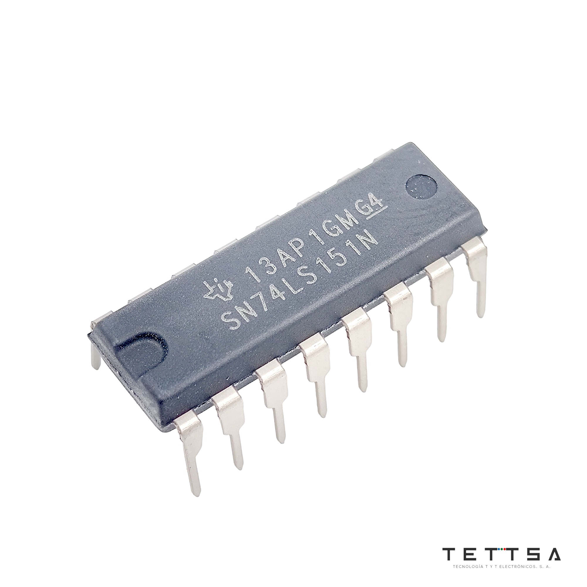
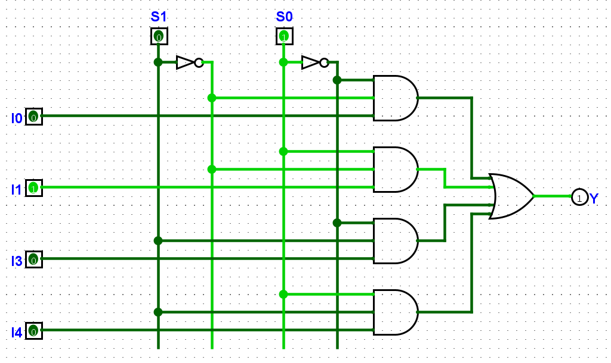

  <h1>⚡ SELECCIÓN Y CODIFICACIÓN DE DATOS ⚡</h1>
  
<i>Unidad 1 • Semana 5 • Diseño de Circuitos Digitales</i>

---

## 🔀 Multiplexor (MUX)

  
  
<em>Figura 1: Multiplexor real.</em>

  <strong style="color: #004c99; font-size: 1.05em;">📘 Definición:</strong> 
  Un multiplexor o selector de datos es aquel que tiene <strong>varias entradas</strong> pero solo <strong>una salida</strong>, es decir, solo deja pasar una de las entradas mediante una selección o control generado por bits (líneas de selección).

---

### 🧩 Partes de un MUX

| 🏷️ Parte | 📖 Explicación | 💡 Ejemplo explicativo |
| :--- | :--- | :--- |
| <strong>📥 2n entradas de datos</strong> | Los datos de entrada solo pueden ser potencias de 2 | <code>23 = 8</code> (I0, I1, I2, I3, I4, I5, I6, I7) |
| <strong>🎛️ n líneas de selección</strong> | De la fórmula 2n que es igual a las entradas, <em>n</em> es la cantidad de bits que controlan la selección | <code>8 = 23</code> por lo tanto <code>n = 3</code>, es decir, habrá tres líneas de selección (3 bits) |
| <strong>📤 1 salida (Y)</strong> | En todo MUX siempre habrá una sola salida | Salida <strong>Y</strong> |
| <strong>🔌 OPCIONAL:</strong> <strong>Entrada de habilitación</strong> | Es una entrada adicional que apaga o enciende el circuito | <ul><li><strong>Si E=1</strong> el MUX funciona de manera normal.</li><li><strong>Si E=0</strong> sin importar las entradas o las líneas de selección la salida (Y) es igual a 0.</li></ul> |

---

***EJEMPLOS:***
 
**MUX 4:1:**
Tiene 4 entradas, es decir, 2² por lo tanto n=2 y habrá 2 líneas de selección. 
| S1 | S0 | Y |
| :--- | :--- | :--- |
| 0 | 0 | I0 |
| 0 | 1 | I1 |
| 1 | 0 | I2 |
| 1 | 1 | I3 |

 

<pre><code>Y = S1' · S0' · I0 + S1' · S0 · I1 + S1 · S0' · I2 + S1 · S0 · I3</code></pre>

---

### 🧮 Ecuación Booleana

Para seleccionar una entrada y bloquear las demás se usan las compuertas lógicas **AND** y **OR**. Tomando el ejemplo anterior:

<pre><code>Y = S1' · S0' · I0 + S1' · S0 · I1 + S1 · S0' · I2 + S1 · S0 · I3</code></pre>

  <strong style="color: #4c2889;">⚙️ ¿Cómo funciona la selección?</strong>
  <ul>
    <li><strong>Minitérminos en S:</strong> Esta ecuación representa un minitérmino en <code>S</code> (donde <code>S = 1</code> y <code>S' = 0</code>), y cada combinación de <code>S</code> representa un número binario (<code>00</code>, <code>01</code>, <code>10</code> y <code>11</code>).</li>
    <li><strong>Condición de paso (AND):</strong> Solo deja pasar la entrada cuando la multiplicación (<strong>AND</strong>) entre las líneas de selección es <code>1</code>, ya que así no afecta al valor de la entrada.</li>
    <li><strong>Dependencia de la salida:</strong> Estas combinaciones de <code>S</code> se multiplican (<strong>AND</strong>) con una entrada (<code>I</code>) porque, siempre y cuando las líneas de selección sean iguales a <code>1</code>, el resultado dependerá o será igual a la entrada (<code>I</code>).</li>
  </ul>

#### 📊 Comportamiento de la compuerta AND como llave de paso

| Selección (`S₁ · S₀`) | Entrada (`I`) | Salida (`Y`) | Estado |
| :---: | :---: | :---: | :--- |
| `0` | `0` | `0` | 🔴 Bloqueado (apagado) |
| `0` | `1` | `0` | 🔴 Bloqueado (apagado) |
| `1` | `0` | `0` | 🟢 Pasa el dato `I` (`0`) |
| `1` | `1` | `1` | 🟢 Pasa el dato `I` (`1`) |

---

### Formación de los circuitos 
Siguiendo el ejemplo de del MUX 4:1 se necesitara:  
* 2 NOT (para S₀` y S₁`´).
* 4 AND  de tres entradas.
* 1 OR de 4 entradas. 

  
  
<em>Figura 2: Implementación de un Multiplexor 4:1 con compuertas lógicas (NOT, AND y OR).</em>

En este circuito mediante las líneas de selección se eligió la entrada (01 = 2) que estará en la salida. Y como se puede ver I1 (la segunda entrada) es igual a 1 y Y = 1. 

### Expanción 
Un MUX más grande se arma con MUX más chicos. Un MUX 8:1 son dos MUX de 4:1 que comparten S1 y S0 más un MUX 2:1 controlado por S2 que elige cuál de los dos resultados pasa. 

 

---

  ✦ • ✦ • ✦

---

 

---

## 🔀 Demultiplexor (DEMUX)

